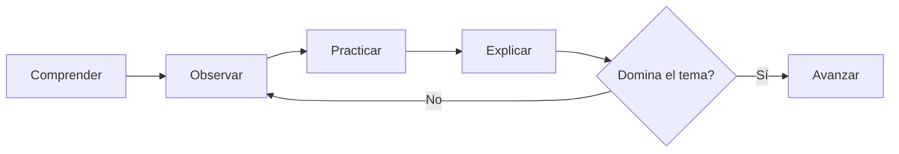

[Inicio](README.md) · [Pensum](PENSUM.md)

# Metodología y evaluación

## Semana típica
- 2 h teoría y fundamentos.
- 2 h demostración y ejercicios.
- 2 h laboratorio.
- 1 h investigación y evaluación.

Cada clase sigue: diagnóstico, explicación desde primeros principios, demostración visual, práctica guiada, reto independiente, evaluación y retroalimentación. No avanzar con vacíos fundamentales.

## Calificación de cada módulo
| Componente | Peso |
|---|---:|
| Laboratorios | 35 % |
| Evaluaciones teóricas | 25 % |
| Proyecto | 25 % |
| Ejercicios e investigación | 15 % |

Aprobación propuesta: 80/100 y dominio de conceptos esenciales. Reforzar errores y permitir reevaluación. El docente puede adaptar tiempos según desempeño. La primera clase ampliada tiene 150 min.

## Seguridad
En electrónica inicial utilizar pilas o fuentes DC de bajo voltaje, nunca red doméstica; evitar cortocircuitos y desconectar antes de cambiar conexiones. No conectar el multímetro en modo corriente directamente a una fuente. Las prácticas de seguridad informática deben limitarse a sistemas propios o autorizados.

## Privacidad
Repositorio público: no guardar calificaciones, nombres de estudiantes, credenciales ni evidencias con información personal. Las soluciones son visibles; entregar las pruebas antes de consultar sus respuestas.

## Ciclo de aprendizaje

> [!IMPORTANT]
> El objetivo no es terminar rápido, sino construir bases sólidas.

[Volver al índice](README.md)
