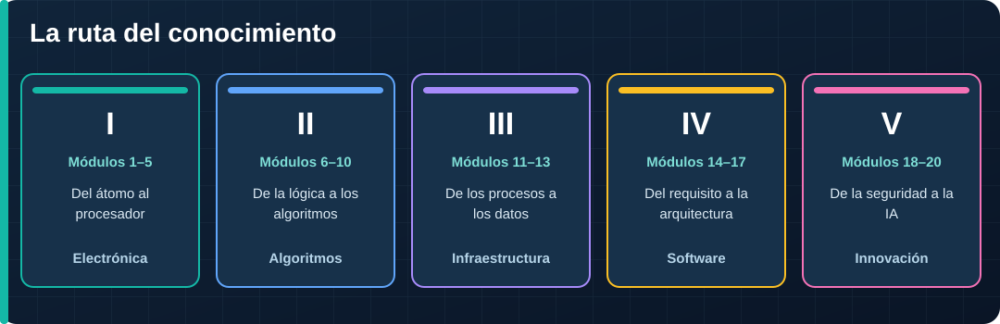

<strong>Un libro abierto de Ingeniería de Sistemas, escrito capítulo a capítulo.</strong>

<a href="modulos/01-electronica-basica/clases/001-materia-atomos-electrones/README.md"><strong>▶ Comenzar a estudiar</strong></a> · <a href="PENSUM.md">Pensum completo</a> · <a href="METODOLOGIA.md">Metodología</a>

---

## Prólogo

Antes de escribir código hay que comprender qué es la información, cómo se representa, cómo circula y qué máquina la procesa. Este libro construye ese conocimiento desde la física hasta el diseño de sistemas reales. Cada capítulo combina lectura, imágenes, ejemplos, experimentos, evaluación y proyectos.

> [!TIP]
> Si empiezas desde cero, sigue el orden de los capítulos. No necesitas saber programar. Dedica al menos siete horas por semana y comprueba que puedes explicar cada concepto con tus propias palabras.

## Cómo utilizar este libro

| Material | Propósito |
|---|---|
| 📖 Lectura | Comprender los fundamentos a tu ritmo. |
| 🖥️ Presentación | Explicación visual con el docente. |
| ✏️ Ejemplos y ejercicios | Aplicar conocimientos y razonar. |
| 🧪 Prácticas | Observar, medir y comprobar. |
| 📝 Pruebas | Demostrar comprensión sin consultar respuestas. |
| 🎬 Recursos | Videos y simulaciones con actividades guiadas. |
| 🔑 Solucionarios | Revisar errores después de resolver. |

## Ruta ampliada de electrónica

**24 semanas · 168 horas mínimas · 72 clases planificadas en los tres primeros capítulos.** [Básica](modulos/01-electronica-basica/clases/README.md) · [Analógica](modulos/02-electronica-analogica/clases/README.md) · [Digital](modulos/03-electronica-digital/clases/README.md).

## Leer como un libro

[▶ Abrir primera página](modulos/01-electronica-basica/clases/001-materia-atomos-electrones/libro/01.md) · [Índice de la clase](modulos/01-electronica-basica/clases/001-materia-atomos-electrones/README.md) · [Biblioteca y descargas](modulos/01-electronica-basica/clases/001-materia-atomos-electrones/descargas.md)

También puedes [descargar la edición interactiva HTML](https://raw.githubusercontent.com/mangelmorenomoreno/academia-sistemas/main/modulos/01-electronica-basica/clases/001-materia-atomos-electrones/libro.html) y abrirla en el navegador para navegar con botones o las flechas del teclado.

## Primera lectura disponible

**[Clase 001 · Materia, átomos y electrones](modulos/01-electronica-basica/clases/001-materia-atomos-electrones/README.md)** — estudia los signos de carga, su transferencia y su relación con los computadores.

[Guía de estudio PDF](modulos/01-electronica-basica/clases/001-materia-atomos-electrones/lecturas/01-guia-de-estudio.pdf) · [Lectura ilustrada](modulos/01-electronica-basica/clases/001-materia-atomos-electrones/lecturas/guia-ampliada.md) · [PowerPoint](modulos/01-electronica-basica/clases/001-materia-atomos-electrones/presentaciones/01-presentacion.pptx)

---

# Índice general del libro

## I · La materia y la máquina

*Del átomo al procesador.*

| Capítulo | Duración | Estado |
| :--- | :---: | :--- |
| [01 · Electricidad y electrónica básica](modulos/01-electronica-basica/README.md) | 8 semanas | Clase 001 disponible |
| [02 · Electrónica analógica](modulos/02-electronica-analogica/README.md) | 8 semanas | Planificado |
| [03 · Electrónica digital y avanzada](modulos/03-electronica-digital/README.md) | 8 semanas | Planificado |
| [04 · Microcontroladores y sistemas embebidos](modulos/04-microcontroladores/README.md) | 4 semanas | Planificado |
| [05 · Arquitectura de computadores](modulos/05-arquitectura-computadores/README.md) | 4 semanas | Planificado |

## II · Razonamiento computacional

*De la lógica a los algoritmos.*

| Capítulo | Duración | Estado |
| :--- | :---: | :--- |
| [06 · Matemáticas discretas y lógica](modulos/06-matematicas-discretas/README.md) | 4 semanas | Planificado |
| [07 · Algoritmos y lógica de programación](modulos/07-algoritmos/README.md) | 4 semanas | Planificado |
| [08 · Programación estructurada](modulos/08-programacion-estructurada/README.md) | 5 semanas | Planificado |
| [09 · Programación orientada a objetos](modulos/09-programacion-orientada-objetos/README.md) | 6 semanas | Planificado |
| [10 · Estructuras de datos y algoritmos avanzados](modulos/10-estructuras-datos/README.md) | 5 semanas | Planificado |

## III · Sistemas conectados

*De los procesos a los datos.*

| Capítulo | Duración | Estado |
| :--- | :---: | :--- |
| [11 · Sistemas operativos](modulos/11-sistemas-operativos/README.md) | 4 semanas | Planificado |
| [12 · Redes y telecomunicaciones](modulos/12-redes/README.md) | 5 semanas | Planificado |
| [13 · Bases de datos relacionales y NoSQL](modulos/13-bases-datos/README.md) | 5 semanas | Planificado |

## IV · Construcción del software

*Del requisito a la arquitectura.*

| Capítulo | Duración | Estado |
| :--- | :---: | :--- |
| [14 · Ingeniería de requisitos y modelado](modulos/14-ingenieria-requisitos/README.md) | 4 semanas | Planificado |
| [15 · Desarrollo web frontend](modulos/15-frontend/README.md) | 5 semanas | Planificado |
| [16 · Desarrollo backend y APIs](modulos/16-backend/README.md) | 6 semanas | Planificado |
| [17 · Arquitectura y calidad de software](modulos/17-arquitectura-software/README.md) | 5 semanas | Planificado |

## V · Ingeniería avanzada

*De la seguridad a la IA.*

| Capítulo | Duración | Estado |
| :--- | :---: | :--- |
| [18 · Seguridad informática](modulos/18-seguridad-informatica/README.md) | 4 semanas | Planificado |
| [19 · Cloud, DevOps y sistemas distribuidos](modulos/19-cloud-devops/README.md) | 6 semanas | Planificado |
| [20 · Inteligencia artificial y proyecto integrador](modulos/20-inteligencia-artificial/README.md) | 7 semanas | Planificado |

---

## Biblioteca de plantillas

[📥 Abrir todas las plantillas](plantillas/README.md) · [Informe de laboratorio PDF](https://raw.githubusercontent.com/mangelmorenomoreno/academia-sistemas/main/plantillas/informe-laboratorio.pdf) · [Cuaderno de análisis PDF](https://raw.githubusercontent.com/mangelmorenomoreno/academia-sistemas/main/plantillas/cuaderno-analisis.pdf) · [Seguimiento privado PDF](https://raw.githubusercontent.com/mangelmorenomoreno/academia-sistemas/main/plantillas/seguimiento.pdf)

## Para el docente

[Metodología y evaluación](METODOLOGIA.md) · [Estándar editorial](plantillas/estandar-materiales.md) · [Plantilla de clase](plantillas/clase.md)

> [!NOTE]
> El libro está en construcción. La clase 001 tiene material desarrollado; los demás contenidos se encuentran planificados. Esta formación independiente no equivale a un título universitario acreditado. Los solucionarios son públicos. No se publican notas ni información personal.

ACADEMIA SISTEMAS · Comprender desde el origen, construir con criterio.

