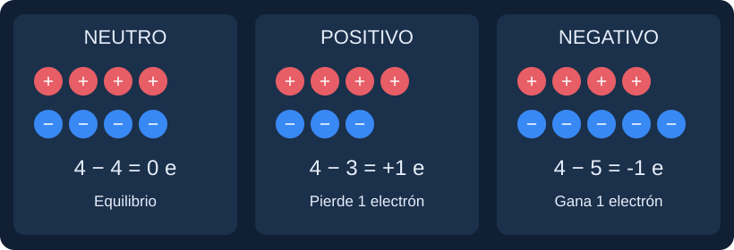
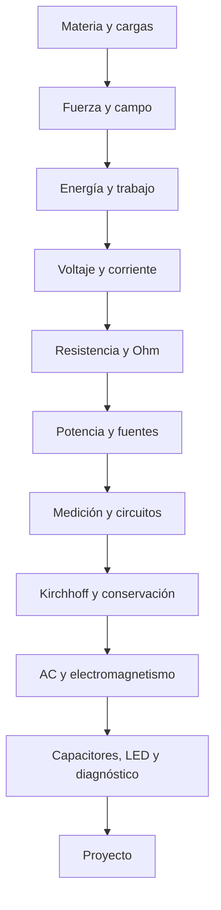

[Inicio](../../README.md) · [Pensum](../../PENSUM.md)

# Capítulo 01 · Electricidad y electrónica básica

> La electricidad es el punto de partida: comprender la materia y el movimiento de cargas permite entender los circuitos que forman un computador.

**8 semanas · 56 horas base · En desarrollo**

## Comienza aquí

**[Clase 001 — Materia, átomos y electrones](clases/001-materia-atomos-electrones/README.md)**

> [!IMPORTANT]
> No utilizar tomacorrientes en las prácticas iniciales. Solo fuentes de bajo voltaje y materiales seguros.

## Qué vas a aprender

[Ver las 24 clases, objetivos, prácticas y criterios de dominio](clases/README.md).

> [!IMPORTANT]
> Antes de la clase 013, los ejercicios eléctricos serán simulados o demostrados por el docente con técnica segura; no se espera que la estudiante mida corriente sin haber aprendido a utilizar el multímetro.

## Biblioteca del capítulo

| Sección | Contenido |
|---|---|
| [📖 Clases](clases/README.md) | Lecturas, presentaciones y actividades |
| [🧪 Laboratorios](laboratorios/README.md) | Experimentos y guías de práctica |
| [📝 Pruebas](pruebas/README.md) | Evaluaciones y criterios |
| [🛠️ Proyecto](proyecto/README.md) | Aplicación integradora |

## Proyecto de cierre

**Circuito de iluminación de bajo voltaje**

[Consulta el montaje, cálculos y seguridad](proyecto/README.md).

---

[← Inicio](../../README.md) · [Índice general](../../README.md) · [Capítulo 02 →](../02-electronica-analogica/README.md)
