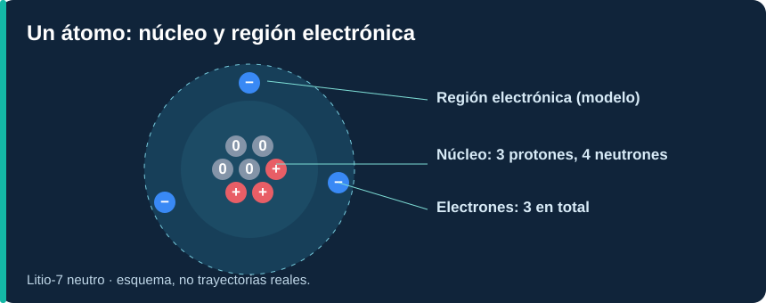
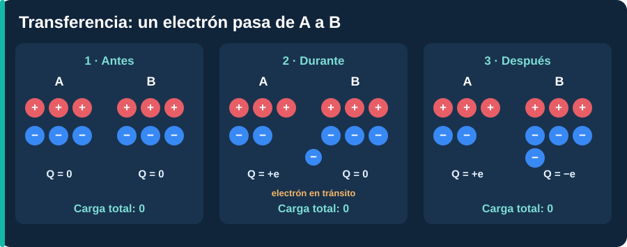

[Inicio](../../../../README.md) · [Capítulo 01](../../README.md) · [Clase 001](README.md)

# Lección 001 · Materia, átomos y electrones

> 150 minutos de clase y trabajo autónomo · Sin conocimientos previos

---

## Antes de comenzar

¿De qué está hecho un cable? ¿Por qué una batería tiene dos terminales? ¿Cómo puede el movimiento de cargas terminar ejecutando un programa?

> [!IMPORTANT]
> Un objeto positivo suele haber perdido electrones, no ganado protones. Un objeto negativo tiene exceso de electrones. Comprender este balance es la base de la lección.

## Tu ruta de estudio

| Paso | Material | Abre o descarga |
|---|---|---|
| 01 | 📖 Lectura ilustrada de ocho secciones | [Leer en GitHub](lecturas/guia-ampliada.md) · [PDF](lecturas/01-guia-de-estudio.pdf) |
| 02 | 🖥️ Presentación de 27 diapositivas | [PPTX](presentaciones/01-presentacion.pptx) · [PDF](presentaciones/01-presentacion.pdf) · [HTML](presentacion.html) |
| 03 | ✏️ Seis ejemplos resueltos y 16 ejercicios | [Leer](ejercicios/ejemplos-y-analisis.md) · [PDF](ejercicios/01-ejemplos-y-analisis.pdf) |
| 04 | 🧪 Tres prácticas con rúbrica | [Leer](practicas/laboratorios-ampliados.md) · [PDF](practicas/01-laboratorios.pdf) |
| 05 | 🎬 Videos y simulaciones | [Biblioteca de recursos](recursos/videos-y-simulaciones.md) |
| 06 | 📝 Evaluación avanzada de 100 puntos | [Leer](pruebas/evaluacion-avanzada.md) · [PDF](pruebas/01-evaluacion-avanzada.pdf) |

## Material complementario y docente

[Teoría inicial](teoria.md) · [Guía docente](guia-docente.md) · [Ejercicios iniciales](ejercicios.md) · [Laboratorio inicial](laboratorio.md) · [Evaluación inicial](evaluacion.md)

🔑 Soluciones y rúbrica (abrir después de responder)

- [Solucionario ampliado en PDF](soluciones/01-solucionario-ampliado.pdf)
- [Solucionario explicado](soluciones/solucionario-ampliado.md)
- [Respuestas iniciales](soluciones/README.md)

> [!NOTE]
> El PPTX publicado es una adaptación independiente de la presentación web, no una copia binaria del PowerPoint original de la conversación. Los diagramas son esquemáticos. Los solucionarios son públicos; no guardes calificaciones personales aquí.

## Al finalizar

Puedes avanzar si explicas con tus propias palabras las partículas del átomo, calculas el signo de una carga, justificas la conservación y distingues transferencia de polarización. La meta de evaluación propuesta es 80/100. Si quedan dudas, repite los ejercicios y la práctica.

[← Índice de clases](../README.md) · Próxima lección: carga eléctrica, electricidad y energía (planificada)
