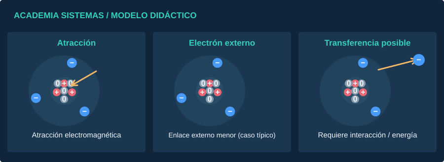
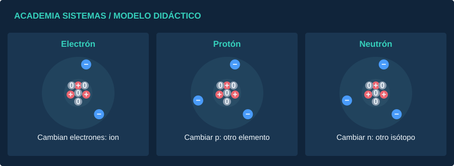
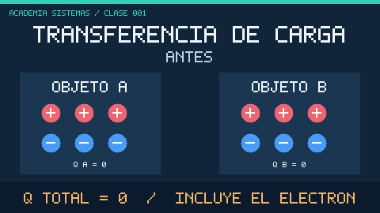

[← Índice](README.md) · [Comenzar libro](libro/01.md) · [Descargas](descargas.md)

# Guía docente · Clase 001

La lección se organiza en 150 minutos de trabajo acompañado y trabajo autónomo adicional. La evaluación avanzada dura 40 minutos y puede presentarse por separado. Las 51 diapositivas representan tres pasos por tema; no es obligatorio proyectarlas todas en una sesión.

| Actividad | Minutos | Lectura |
|---|---:|---|
| Diagnóstico y materia | 10 | [01](libro/01.md) |
| Átomo, enlace electrónico y núcleo | 30 | [02](libro/02.md) · [03](libro/03.md) · [04](libro/04.md) |
| Balance, conservación y fuerzas | 25 | [05](libro/05.md) · [06](libro/06.md) · [07](libro/07.md) |
| Frotamiento, contacto, polarización e inducción | 30 | [08](libro/08.md) a [11](libro/11.md) |
| Materiales, corriente y software | 20 | [12](libro/12.md) a [14](libro/14.md) |
| Práctica de fichas y globo | 25 | [15](libro/15.md) |
| Repaso y sustentación | 10 | [16](libro/16.md) · [17](libro/17.md) |

## Concepto crítico: ¿por qué pierde electrones?

Pide a la estudiante que explique de dónde sale la energía para cambiar el estado electrónico. No basta decir que el electrón está fuera: debe relacionar la interacción electromagnética, el apantallamiento, los estados electrónicos de materiales y el aporte de energía o interacción.

Pregunta qué cambia al retirar un electrón, un protón o un neutrón: ion, elemento e isótopo respectivamente, en condiciones hipotéticas apropiadas.

Haz que prediga el signo antes de mover fichas; contabiliza el electrón en tránsito. Repite si confunde déficit con exceso.

## Evaluación

Usa la [prueba avanzada PDF](pruebas/01-evaluacion-avanzada.pdf) y el [solucionario PDF](soluciones/01-solucionario-ampliado.pdf). Meta: 80/100 y dominio de los conceptos fundamentales. Los resultados se conservan de manera privada.

[← Índice](README.md) · [Primera página →](libro/01.md)
