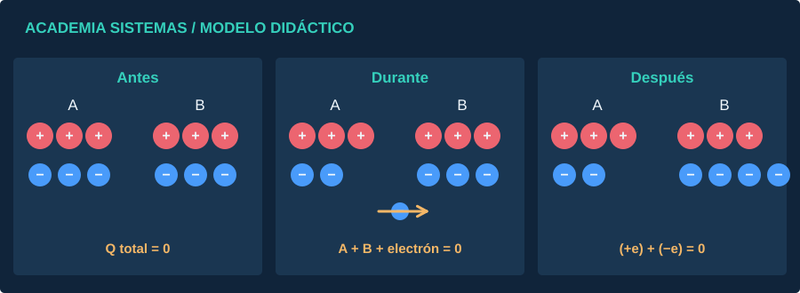
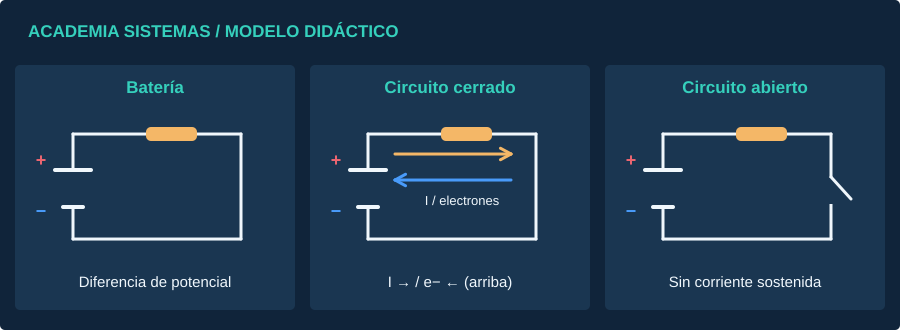

# Libro ilustrado — Clase 001

[← Índice de páginas](../README.md) · [PDF](https://raw.githubusercontent.com/mangelmorenomoreno/academia-sistemas/main/modulos/01-electronica-basica/clases/001-materia-atomos-electrones/lecturas/01-guia-de-estudio.pdf)

## 01. De un cable al átomo

**Objeto.** Un cable real contiene un núcleo metálico y una cubierta aislante. Ambos son materia: tienen masa y ocupan espacio.

**Material.** Al ampliar el cobre aparecen átomos organizados en una red. No todo material está hecho de moléculas independientes.

**Átomo.** Un átomo de cobre tiene 29 protones. El número de protones define el elemento; los electrones permiten muchas de sus interacciones.

> **Ejemplo:** Imagina que cortas y amplías un cable de cobre. ¿Qué cambia al pasar de la escala del cable a la escala atómica?

**Comprueba:** Identifica un conductor y un aislante en un cable desconectado. No lo cortes si está conectado a una fuente.

[Leer página individual](../libro/01.md)

---

## 02. Dentro del átomo

**Núcleo.** Contiene protones de carga +e y, normalmente, neutrones de carga cero. El hidrógeno-1 es una excepción: su núcleo solo tiene un protón.

**Región electrónica.** Los electrones tienen carga −e y se describen mediante estados cuánticos. Los dibujos de capas representan regiones, no trayectorias reales.

**Ejemplo: litio-7.** Tiene 3 protones, 4 neutrones y, si es neutro, 3 electrones. Los protones y neutrones concentran casi toda la masa.

> **Ejemplo:** En litio-7, 3(+e)+3(−e)+4(0)=0. Quitar un electrón cambia la carga pero no los 3 protones.

**Comprueba:** Dibuja litio-7 con 3 protones, 4 neutrones y 3 electrones. Usa rojo para +, azul para − y gris para 0.

[Leer página individual](../libro/02.md)

---

## 03. ¿Qué mantiene unido al electrón?

**Atracción.** El núcleo positivo atrae a los electrones negativos mediante la interacción electromagnética. Los electrones también se repelen entre sí.

**Apantallamiento.** En átomos con varios electrones, los internos reducen en parte la atracción efectiva sobre los externos. Algunos electrones de valencia están menos ligados; en sólidos importan también los enlaces y estados electrónicos.

**Aporte de energía.** Un electrón no sale porque sí. Una interacción con otro material, radiación, calor o un campo suficientemente intenso puede permitir que cambie de estado o se transfiera. Arrancarlo de un átomo aislado requiere energía de ionización.

> **Ejemplo:** Para un átomo de litio aislado, la primera energía de ionización es aproximadamente 5,4 eV. Quitar electrones internos exige mucho más. Es un ejemplo, no el umbral universal de frotamiento.

**Comprueba:** Explica por qué no todos los electrones son igualmente fáciles de extraer. ¿De dónde procede la energía?

[Leer página individual](../libro/03.md)

---

## 04. ¿Por qué no se mueve un protón o un neutrón?

**Electrón.** Está ligado electromagnéticamente fuera del núcleo. En la electrización ordinaria de sólidos pueden redistribuirse algunos electrones, sin alterar los núcleos.

**Protón.** Está en el núcleo, ligado por interacciones nucleares. Cambiar el número de protones cambia el elemento: carbono tiene 6 y nitrógeno 7. Separar un protón es un proceso nuclear, no de frotamiento.

**Neutrón.** También está ligado en el núcleo y no tiene carga neta. Perder un neutrón cambia el isótopo, no la carga neta por sí solo. Un neutrón no contiene un electrón que se desprenda al frotar.

> **Ejemplo:** Carbono-12: 6p, 6n, 6e. Si pierde un electrón: C⁺, con 6p y 5e. Si cambiara el número de neutrones, sería otro isótopo; si cambiara el de protones, otro elemento.

**Comprueba:** Compara qué cambia en cada caso: elemento, isótopo y carga. La física nuclear no forma parte del laboratorio de esta clase.

[Leer página individual](../libro/04.md)

---

## 05. Carga neutra, positiva y negativa

**Neutra.** Las cargas se compensan. Un modelo con 4 cargas positivas y 4 negativas tiene carga neta cero, aunque contiene partículas cargadas.

**Positiva.** Si ese modelo pierde un electrón, quedan 4 positivas y 3 negativas. Hay déficit de electrones; no aparecen protones nuevos.

**Negativa.** Si el modelo neutro gana un electrón, quedan 4 positivas y 5 negativas. Hay exceso de electrones. El electrón proviene de otro sistema.

> **Ejemplo:** Q = (Np − Ne)e. La magnitud e = 1,602 176 634 × 10⁻¹⁹ C. Para un átomo, un déficit de electrones produce un catión y un exceso puede producir un anión si el estado es estable.

**Comprueba:** Calcula Q/e para 8p/8e, 11p/10e y 17p/18e. ¿Qué sucede con Q si el cuerpo pierde un electrón pero ya era negativo?

[Leer página individual](../libro/05.md)

---

## 06. Transferencia y conservación

**Antes.** A y B empiezan neutros: 3 positivas y 3 negativas en cada uno. La suma de sus cargas es cero.

**Durante.** Una interacción permite que un electrón salga de A y vaya hacia B. Mientras está en tránsito, debe contarse también su carga −e.

**Después.** A conserva 3 positivas y 2 negativas: +e. B queda con 3 positivas y 4 negativas: −e. El sistema completo sigue teniendo carga neta cero.

> **Ejemplo:** Si se transfieren 5 electrones de A a B inicialmente neutros: A = +5e y B = −5e; suma = 0. La energía puede cambiar de forma, pero la carga total se conserva en el sistema aislado.

**Comprueba:** Dibuja dos objetos neutros. Transfiere tres electrones y luego devuelve uno. Calcula ambos signos en cada etapa.

[Leer página individual](../libro/06.md)

---

## 07. Atracción y repulsión

**Iguales positivas.** Dos cargas + se repelen. Las fuerzas sobre cada una tienen sentidos opuestos.

**Iguales negativas.** Dos cargas − también se repelen. Negativo no significa que no exista fuerza.

**Opuestas.** Una carga + y otra − se atraen. Para cargas puntuales en el vacío, F = k|q₁q₂|/r²: al duplicar la distancia, la magnitud queda en un cuarto.

> **Ejemplo:** Si la fuerza era 8 N a cierta distancia, al duplicar la distancia en el modelo ideal será 2 N. No hace falta contacto para que actúe la fuerza.

**Comprueba:** Dibuja los sentidos de fuerza para los tres casos. ¿La atracción permite concluir que ambos cuerpos tienen carga neta opuesta? Justifica.

[Leer página individual](../libro/07.md)

---

## 08. Electrización por frotamiento

**Antes.** Globo y tela pueden estar inicialmente neutros. Sus materiales tienen distintos estados y afinidades para las cargas en sus superficies.

**Contacto repetido.** Frotar aumenta los contactos y separaciones microscópicas; algunos electrones pueden quedar en el otro material. El trabajo mecánico facilita separar las cargas. El mecanismo detallado depende de la superficie.

**Separación.** En un caso típico, electrones pasan de una tela al globo: tela positiva, globo negativo. No siempre se obtiene el mismo signo; depende de materiales, humedad y condiciones.

> **Ejemplo:** Una transferencia de 10 electrones del paño al globo deja +10e en el paño y −10e en el globo, si ambos eran neutros y se aíslan del entorno.

**Comprueba:** Predice cómo cambia el resultado con una tela distinta. La prueba del papel no determina por sí sola el signo de la carga.

[Leer página individual](../libro/08.md)

---

## 09. Electrización por contacto

**Separados.** Dos conductores pueden tener diferente potencial eléctrico. Supón esferas idénticas, aisladas, con −4e y 0.

**Contacto.** Al unirlos, los electrones móviles se redistribuyen por el campo eléctrico hasta el equilibrio electrostático. No se transfieren protones entre los sólidos.

**Equilibrio.** Al separarlas, el modelo ideal da −2e en cada esfera. El reparto igual requiere simetría; no es una regla universal para cualquier geometría.

> **Ejemplo:** Carga total inicial −4e + 0 = −4e. Final −2e −2e = −4e. Si las esferas son iguales y tienen +6e y −2e, el reparto ideal es +2e en cada una.

**Comprueba:** ¿En qué sentido neto se desplazan electrones si una esfera es positiva y otra negativa?

[Leer página individual](../libro/09.md)

---

## 10. Polarización: atraer sin tocar

**Papel neutro.** El papel contiene cargas positivas y negativas compensadas. Muchas cargas están ligadas en moléculas.

**Globo cercano.** El campo de un globo negativo desplaza ligeramente la distribución electrónica dentro del papel o reorienta dipolos. El lado próximo presenta carga positiva relativa.

**Atracción.** La atracción de las cargas opuestas más cercanas puede superar la repulsión de las negativas más alejadas. La carga neta del papel puede seguir siendo cero; no necesita recibir electrones del globo.

> **Ejemplo:** La atracción de un papel no prueba que esté cargado positivamente. También ocurre con cuerpos neutros polarizables.

**Comprueba:** Dibuja cuatro pares +/− dentro del papel antes y después. Conserva exactamente las mismas cargas.

[Leer página individual](../libro/10.md)

---

## 11. Inducción con conexión a tierra

**Acercar.** Una varilla negativa cerca de un conductor neutro redistribuye sus electrones. Aún no cambia su carga total.

**Conectar a tierra.** En un modelo electrostático, la repulsión permite que salgan electrones hacia tierra. La Tierra actúa como reservorio de carga.

**Desconectar y retirar.** Primero se retira la conexión a tierra y luego la varilla. El conductor queda con déficit de electrones. El balance se conserva al incluir la Tierra.

> **Ejemplo:** No confundir polarización sola (Q del cuerpo no cambia) con inducción que incluye intercambio de carga con tierra. Esta secuencia es conceptual, no una instrucción para usar la red.

**Comprueba:** Ordena los pasos y explica qué ocurriría si no hubiera camino para que salieran electrones. No conectar nada a un tomacorriente.

[Leer página individual](../libro/11.md)

---

## 12. Conductores, aislantes y semiconductores

**Conductor.** En cobre y otros metales existen estados electrónicos que permiten transportar carga; los iones de la red no recorren el cable.

**Aislante.** En plástico o vidrio las cargas están mucho menos disponibles para el transporte en condiciones ordinarias. Pueden polarizarse o acumular carga localizada.

**Semiconductor.** En silicio la población y movilidad de portadores pueden controlarse mediante dopaje, temperatura, luz o campos. Eso permite dispositivos electrónicos.

> **Ejemplo:** Un cable de cobre neutro puede conducir corriente. Un globo con carga negativa puede ser aislante. La carga neta y la conductividad son conceptos distintos.

**Comprueba:** Identifica en un cable y un chip dónde hay conductor, aislante y semiconductor. No desmontes equipos energizados.

[Leer página individual](../libro/12.md)

---

## 13. Corriente eléctrica y batería

**Campo eléctrico.** En un metal sin campo aplicado, el movimiento microscópico no tiene deriva neta. Una batería mantiene diferencia de potencial mediante procesos químicos.

**Circuito cerrado.** El campo eléctrico se establece en el circuito y los electrones adquieren deriva promedio. En el tramo superior del ejemplo salen convencionalmente del + hacia la resistencia; los electrones derivan en sentido contrario.

**Circuito abierto.** Sin camino cerrado no hay corriente sostenida. La corriente I = ΔQ/Δt mide carga que cruza una sección por tiempo. 1 A = 1 C/s. La resistencia transfiere energía, no consume electrones.

> **Ejemplo:** En un circuito externo metálico de batería: corriente convencional del + al −; deriva electrónica del − al +. La propagación de la señal es mucho más rápida que la deriva individual.

**Comprueba:** Dibuja la batería, resistencia e interruptor. Señala ambos sentidos en el mismo tramo y predice qué pasa al abrir el interruptor.

[Leer página individual](../libro/13.md)

---

## 14. Del electrón al software

**Transistor.** El control del transporte de carga en materiales semiconductores permite fabricar transistores, componentes capaces de controlar señales.

**Lógica y procesador.** Combinaciones de transistores forman compuertas. Los circuitos digitales interpretan rangos de señal como 0 y 1. Registros, ALU y memoria permiten procesar y almacenar datos.

**Programa.** El software expresa instrucciones y algoritmos. Según el lenguaje y entorno, estos se traducen o interpretan y terminan siendo ejecutados por hardware. Un bit no es un electrón individual.

> **Ejemplo:** Una suma 5 + 3 en Java acaba relacionándose con operaciones de máquina, aunque el compilador y la JVM pueden optimizar cómo se ejecuta.

**Comprueba:** Explica el camino átomo → semiconductor → transistor → compuerta → CPU → programa, sin memorizar palabras aisladas.

[Leer página individual](../libro/14.md)

---

## 15. Laboratorio guiado: globo y fichas

**Fichas.** Usa dos hojas A y B con 6 fichas rojas y 6 azules en cada una. Mueve una azul de A a B, luego dos más y devuelve dos. Registra cantidades y cargas en cada paso.

**Globo y papel.** Materiales: globo, tela seca, trozos de papel y regla. Acerca sin frotar y registra; frota 10 segundos; acerca a distancia comparable; repite tres veces.

**Simulación.** Abre PhET Globos y electricidad estática. Muestra todas las cargas, frota el globo contra el jersey y acércalo a la pared. Dibuja antes y después; observa polarización.

> **Ejemplo:** No deduzcas el signo del globo solo porque atrae papel. Registra humedad, distancia y resultados; una ausencia de atracción también es un resultado válido. Mantén globos cargados lejos de electrónica sensible y líquidos inflamables. No uses red eléctrica.

**Comprueba:** Entrega hipótesis, tabla de resultados, dibujos, explicación, limitaciones y conclusión. Usa la plantilla de laboratorio.

[Leer página individual](../libro/15.md)

---

## 16. Ejercicios: razonar paso a paso

**Balance.** A: 12p y 10e. B: 9p y 10e. Calcula Q/e. Un objeto con −7e pierde 4 electrones: ¿qué carga conserva?

**Transferencia.** A y B neutros: A entrega cinco electrones y B devuelve dos. Dibuja antes, durante y después, y calcula la suma. Dos esferas iguales con +6e y −2e se conectan: calcula reparto ideal.

**Interpretación.** Explica por qué la fricción no crea electrones; por qué un papel neutro es atraído; qué diferencia un aislante de un conductor; qué sentido tienen corriente y electrones en un mismo tramo.

> **Ejemplo:** Ejemplo resuelto: 11p y 10e ⇒ Q=(11−10)e=+e. Otro: −7e pierde cuatro cargas −e ⇒ −7e+4e=−3e. No confundas signo con cantidad de electrones transferidos.

**Comprueba:** Resuelve en tu cuaderno y descarga el cuaderno de ejercicios. Consulta el solucionario solo después.

[Leer página individual](../libro/16.md)

---

## 17. Evaluación y sustentación

**Parte A · 40 puntos.** 1) Define átomo y elemento (8). 2) Identifica cargas y ubicación de las partículas (8). 3) Calcula Q/e en 8p/8e, 11p/10e, 17p/18e y 6p/4e (8). 4) Justifica por qué sale un electrón y no un neutrón (8). 5) Dibuja fuerzas y efecto de duplicar distancia (8).

**Parte B · 60 puntos.** 6) A y B neutros; A cede 4e: balance (15). 7) Compara frotamiento, contacto y polarización (15). 8) Clasifica materiales con ejemplos (10). 9) Dibuja circuito y sentidos (10). 10) Explica la relación con CPU y software (10).

**Sustentación.** Sin leer, explica qué energía permite transferir electrones, qué cambia al perder un protón o neutrón, y por qué la carga se conserva. Meta: 80/100 y dominio de estos conceptos.

> **Ejemplo:** El examen es individual y dura aproximadamente 40 minutos adicionales. La ilustración del examen es una referencia de contexto, no contiene las respuestas. Los resultados personales no deben subirse a este repositorio público.

**Comprueba:** Descarga la prueba y la plantilla de seguimiento. El docente puede solicitar una reevaluación de los conceptos no dominados.

[Leer página individual](../libro/17.md)

---
