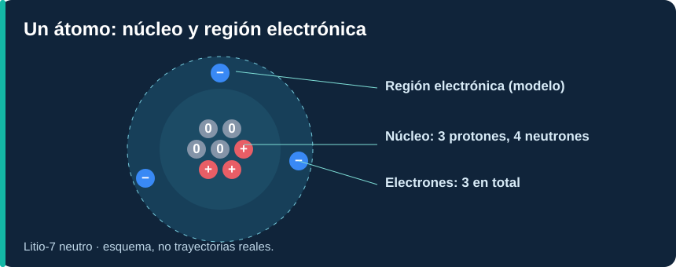
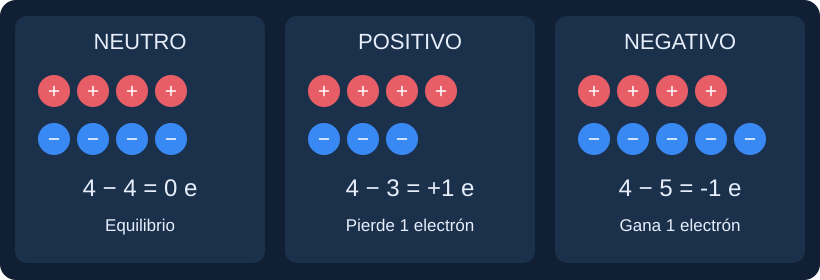
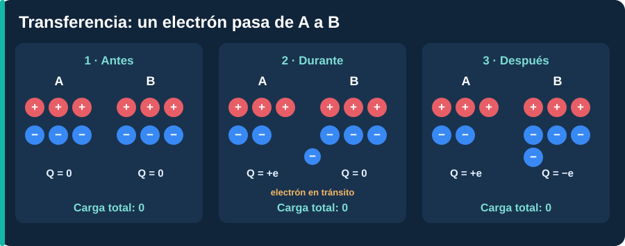
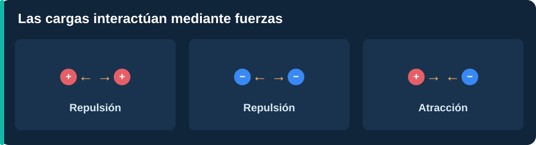
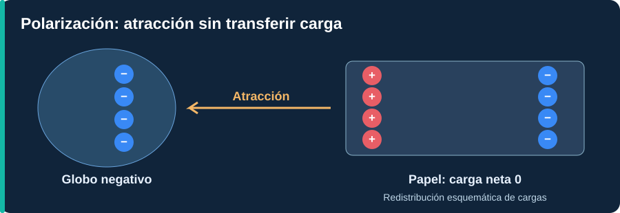
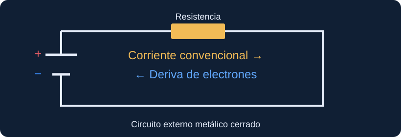
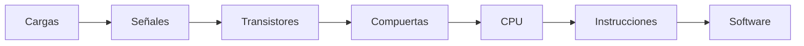

[Inicio](../../../../../README.md) · [Capítulo 01](../../../README.md) · [Clase 001](../README.md)

# Lectura ilustrada · Materia, átomos y electrones

> Guía de estudio · Ocho secciones · Nivel inicial

---

[Descargar guía en PDF](01-guia-de-estudio.pdf)

## En esta lectura

- 1. Materia y estructura atómica
- 2. Cómo se determina el signo de la carga
- 3. Cómo se transfieren las cargas
- 4. Fuerza eléctrica: atracción y repulsión
- 5. Frotamiento, contacto e inducción
- 6. Conductores, aislantes y semiconductores
- 7. Del movimiento de electrones a la corriente
- 8. De la física a la ingeniería de sistemas

> [!TIP]
> Lee una sección, detente y explica lo aprendido. Después dibuja el fenómeno y resuelve los ejemplos.

---

## 1. Materia y estructura atómica

*Figura. Modelo del litio-7: partículas del núcleo y electrones.*

Objetivos: distinguir materia, átomo, elemento, molécula y partículas; calcular el signo de una carga; explicar transferencia, conservación y corriente.

La materia ordinaria tiene masa y ocupa espacio. Un elemento químico se identifica por el número de protones de sus átomos. Por ejemplo, el cobre tiene 29 protones y el silicio 14. Los átomos pueden unirse en moléculas o formar redes cristalinas, como en los metales.

El núcleo contiene protones y, normalmente, neutrones. Los electrones ocupan estados cuánticos llamados orbitales: no recorren órbitas planetarias fijas. El núcleo es muy pequeño respecto al átomo y contiene casi toda su masa.

Un protón tiene carga +e; un electrón tiene carga -e; un neutrón tiene carga neta cero. La letra e representa una magnitud positiva: 1,602 176 634 x 10^-19 C (culombios).

> [!TIP]
> **Ejemplo:** un átomo de litio neutro tiene 3 protones y 3 electrones. El litio-7 tiene además 4 neutrones. Cambiar los electrones modifica la carga, no la identidad química del elemento.

> [!TIP]
> **Pregunta:** ¿qué cambia si el litio pierde un electrón? ¿Qué pasaría si cambiara su número de protones?

## 2. Cómo se determina el signo de la carga

*Figura. El signo depende del balance de cargas positivas y negativas.*

La carga es una propiedad física, no una sustancia ni sinónimo de energía. Positivo y negativo son signos de una propiedad que determina interacciones eléctricas.

Para un sistema con Np protones y Ne electrones, Q = (Np - Ne)e. Los neutrones no intervienen en este balance. Si Np = Ne, Q = 0; si Np > Ne, Q > 0; si Np < Ne, Q < 0.

> [!TIP]
> **Ejemplo A:** 4 protones y 4 electrones. Q = (4 - 4)e = 0. El objeto contiene cargas, pero se compensan.

> [!TIP]
> **Ejemplo B:** 4 protones y 3 electrones. Q = (4 - 3)e = +e. Hay déficit de electrones. No se han creado protones.

> [!TIP]
> **Ejemplo C:** 4 protones y 5 electrones. Q = (4 - 5)e = -e. Hay exceso de electrones. Para un átomo se habla de catión o anión; para un objeto macroscópico, de carga neta.

> [!IMPORTANT]
> **Error frecuente:** decir que neutro significa que no hay electrones. Significa que la suma de cargas es cero.

## 3. Cómo se transfieren las cargas

*Figura. Antes, durante y después: la carga total no cambia.*

En la electrización ordinaria de sólidos, se desplazan electrones; los protones quedan ligados a los núcleos. No todos los electrones son igualmente móviles. En líquidos o gases también puede haber transporte de iones.

Imagina dos objetos A y B, cada uno con 3 cargas positivas y 3 negativas. Un electrón sale de A y llega a B. A queda con 3 positivas y 2 negativas: +e. B queda con 3 positivas y 4 negativas: -e.

Antes: Qtotal = 0 + 0 = 0. Después: Qtotal = (+e) + (-e) = 0. La carga total de un sistema aislado se conserva.

> [!TIP]
> **Ejemplo numérico:** si se transfieren 5 electrones de A a B, A queda con +5e y B con -5e, magnitud 8,0109 x 10^-19 C. El signo indica déficit o exceso, no dirección del movimiento.

La energía requerida para separar o mover las cargas procede del entorno, por ejemplo del trabajo de frotar dos materiales. La carga y la energía son magnitudes distintas.

## 4. Fuerza eléctrica: atracción y repulsión

*Figura. Cargas iguales se repelen; opuestas se atraen.*

Dos cargas de signos iguales se repelen; dos de signos contrarios se atraen. Un campo eléctrico describe la fuerza por unidad de carga de prueba positiva en un punto.

En electrostática, para dos cargas puntuales en el vacío, la magnitud de la fuerza se modela como F = k |q1 q2| / r^2. k es aproximadamente 8,99 x 10^9 N m^2/C^2. No es necesario memorizar la constante en esta clase.

Si la distancia se duplica manteniendo las cargas, la fuerza es cuatro veces menor. Si se reduce a la mitad, la fuerza es cuatro veces mayor.

Un cuerpo neutro puede atraer o ser atraído por un cuerpo cargado cuando sus cargas se redistribuyen. Neutralidad no significa ausencia de interacción.

> [!TIP]
> **Reto:** dibuja flechas de fuerza para dos cargas negativas, dos positivas y una de cada signo. Las fuerzas sobre cada carga tienen sentidos opuestos.

## 5. Frotamiento, contacto e inducción

*Figura. El globo atrae al papel por redistribución.*

Frotamiento: al entrar en contacto y separarse dos materiales, pueden transferirse electrones. Un globo y una tela seca son un ejemplo. El signo adquirido depende de los materiales y las condiciones.

Contacto: si un conductor cargado toca otro conductor, las cargas pueden redistribuirse hasta el equilibrio electrostático. Dos esferas conductoras idénticas, aisladas y alejadas de otros cuerpos, con cargas -4e y 0, idealmente quedan con -2e cada una.

Polarización: un objeto cargado cercano puede redistribuir cargas en un cuerpo neutro. No hace falta contacto ni transferencia entre objetos. El papel atraído por el globo puede seguir siendo neutro.

Inducción con puesta a tierra: un conductor neutro cerca de un objeto negativo puede perder electrones hacia tierra. Si se desconecta tierra antes de retirar el inductor, queda cargado positivamente. La Tierra también forma parte del balance total.

Comparación: frotamiento y contacto pueden transferir carga entre objetos; polarización sola no cambia la carga neta; inducción con tierra puede cambiarla. Nunca usar un tomacorriente en estas demostraciones.

## 6. Conductores, aislantes y semiconductores

En los metales algunos electrones se encuentran en estados que permiten transportar carga. El cobre se usa por su buena conductividad y facilidad de fabricación. Los iones de la red no recorren el cable.

En un aislante, los electrones no se desplazan libremente a través del material en condiciones normales. Plástico, vidrio y cerámica son ejemplos. El plástico de un cable reduce el riesgo de contacto y de cortocircuito.

El silicio es semiconductor. Su conductividad puede variar con temperatura, iluminación, impurezas y campos eléctricos. Eso permite construir diodos y transistores.

La conductividad no es lo mismo que carga neta: un cable de cobre neutro puede conducir corriente. Un plástico cargado puede retener carga localizada y no ser buen conductor.

Caso: ¿por qué un cable tiene metal interno y aislamiento externo? ¿Qué pasa si se deteriora la cubierta? No manipules cables conectados a la red.

## 7. Del movimiento de electrones a la corriente

*Figura. Sentidos de corriente convencional y deriva electrónica.*

Sin campo eléctrico aplicado, en un metal hay movimiento microscópico pero no deriva neta. Al establecer un campo, aparece una deriva promedio de los electrones opuesta al campo.

Una pila convierte energía química en energía eléctrica y mantiene una diferencia de potencial entre terminales. Un circuito externo cerrado ofrece un camino para corriente sostenida; con un interruptor abierto no hay corriente sostenida.

En un circuito externo metálico, la corriente convencional va del terminal positivo al negativo. Los electrones tienen deriva del negativo al positivo. La convención no es un error: define el sentido del transporte de carga positiva.

La corriente es carga que atraviesa una sección por unidad de tiempo: I = Q/t (para corriente media). Un amperio corresponde a un culombio por segundo. La carga no se consume en un componente; se transfiere energía.

La señal eléctrica se propaga mucho más rápido que la deriva de cada electrón. Al encender una lámpara, no es necesario esperar a que un electrón recorra todo el cable. Voltaje, resistencia y medición se estudiarán después.

## 8. De la física a la ingeniería de sistemas

Los procesadores y memorias se construyen con circuitos de transistores semiconductores. Un transistor puede controlar corriente mediante una señal. Combinando transistores se construyen compuertas lógicas.

Los circuitos digitales representan información mediante rangos de señales, por ejemplo niveles que interpretamos como 0 y 1. No significa que un bit sea un electrón individual.

Una ALU combina señales para realizar operaciones aritméticas y lógicas; memoria y registros almacenan estados. Las instrucciones de máquina controlan operaciones. Un lenguaje de alto nivel expresa algoritmos que pueden traducirse o interpretarse.

> [!TIP]
> **Ejemplo:** resultado = 5 + 3. El lenguaje expresa una operación; el entorno de ejecución y procesador realizan instrucciones. La realización física depende de circuitos digitales.

> [!TIP]
> **Autoevaluación:** explica en orden átomo, electrón, señal, transistor, compuerta, CPU y software. Identifica qué temas todavía no puedes explicar y anótalos.

Lecturas y recursos recomendados: Khan Academy (conservación de la carga); PhET (globos y electricidad estática); ANEP Uruguay (formas de electrizar un cuerpo). En el repositorio están los enlaces y preguntas guiadas.

---

ACADEMIA SISTEMAS · [Volver a la lección](../README.md)
