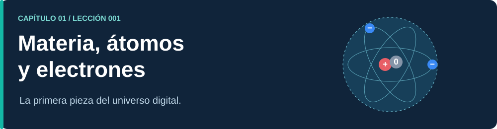
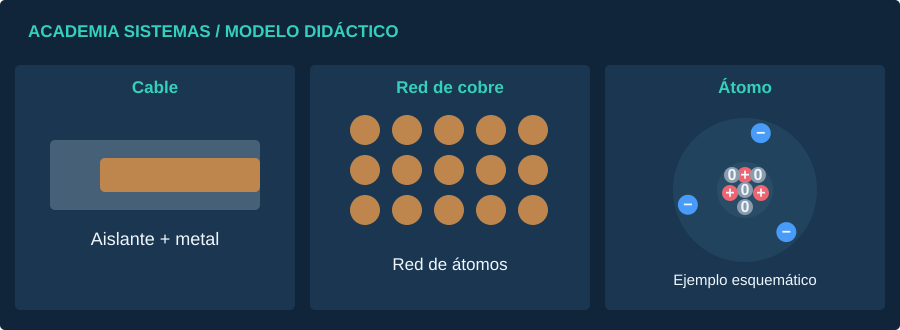

[← Portada](../README.md) · [Índice](../README.md) · [Siguiente →](02.md)

**LECCIÓN 001 · PÁGINA 1 DE 17**

# De un cable al átomo

> ¿De qué está hecha la tecnología?

*Figura 1. Representación esquemática; tamaños y posiciones no están a escala.*

## 1. Objeto

Un cable real contiene un núcleo metálico y una cubierta aislante. Ambos son materia: tienen masa y ocupan espacio.

## 2. Material

Al ampliar el cobre aparecen átomos organizados en una red. No todo material está hecho de moléculas independientes.

## 3. Átomo

Un átomo de cobre tiene 29 protones. El número de protones define el elemento; los electrones permiten muchas de sus interacciones.

> [!TIP]
> **Ejemplo explicado:** Imagina que cortas y amplías un cable de cobre. ¿Qué cambia al pasar de la escala del cable a la escala atómica?

### Comprueba lo aprendido

Identifica un conductor y un aislante en un cable desconectado. No lo cortes si está conectado a una fuente.

---

[← Portada](../README.md) · [Índice](../README.md) · [Siguiente →](02.md)
