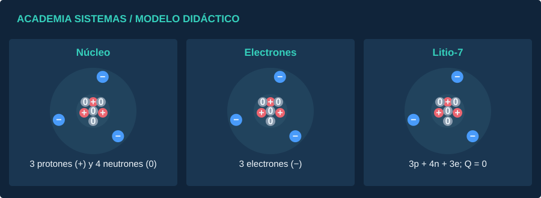

[← Anterior](01.md) · [Índice](../README.md) · [Siguiente →](03.md)

**LECCIÓN 001 · PÁGINA 2 DE 17**

# Dentro del átomo

> ¿Dónde están las partículas?

*Figura 2. Representación esquemática; tamaños y posiciones no están a escala.*

## 1. Núcleo

Contiene protones de carga +e y, normalmente, neutrones de carga cero. El hidrógeno-1 es una excepción: su núcleo solo tiene un protón.

## 2. Región electrónica

Los electrones tienen carga −e y se describen mediante estados cuánticos. Los dibujos de capas representan regiones, no trayectorias reales.

## 3. Ejemplo: litio-7

Tiene 3 protones, 4 neutrones y, si es neutro, 3 electrones. Los protones y neutrones concentran casi toda la masa.

> [!TIP]
> **Ejemplo explicado:** En litio-7, 3(+e)+3(−e)+4(0)=0. Quitar un electrón cambia la carga pero no los 3 protones.

### Comprueba lo aprendido

Dibuja litio-7 con 3 protones, 4 neutrones y 3 electrones. Usa rojo para +, azul para − y gris para 0.

---

[← Anterior](01.md) · [Índice](../README.md) · [Siguiente →](03.md)
