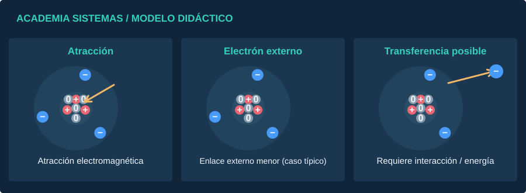

[← Anterior](02.md) · [Índice](../README.md) · [Siguiente →](04.md)

**LECCIÓN 001 · PÁGINA 3 DE 17**

# ¿Qué mantiene unido al electrón?

> La atracción eléctrica y la energía de enlace

*Figura 3. Representación esquemática; tamaños y posiciones no están a escala.*

## 1. Atracción

El núcleo positivo atrae a los electrones negativos mediante la interacción electromagnética. Los electrones también se repelen entre sí.

## 2. Apantallamiento

En átomos con varios electrones, los internos reducen en parte la atracción efectiva sobre los externos. Algunos electrones de valencia están menos ligados; en sólidos importan también los enlaces y estados electrónicos.

## 3. Aporte de energía

Un electrón no sale porque sí. Una interacción con otro material, radiación, calor o un campo suficientemente intenso puede permitir que cambie de estado o se transfiera. Arrancarlo de un átomo aislado requiere energía de ionización.

> [!TIP]
> **Ejemplo explicado:** Para un átomo de litio aislado, la primera energía de ionización es aproximadamente 5,4 eV. Quitar electrones internos exige mucho más. Es un ejemplo, no el umbral universal de frotamiento.

### Comprueba lo aprendido

Explica por qué no todos los electrones son igualmente fáciles de extraer. ¿De dónde procede la energía?

---

[← Anterior](02.md) · [Índice](../README.md) · [Siguiente →](04.md)
