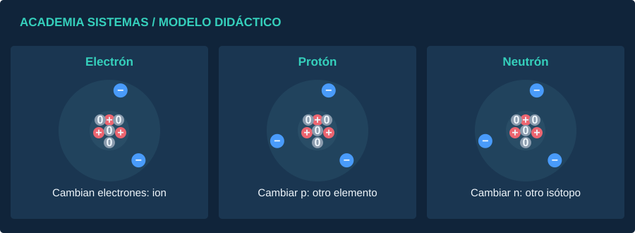

[← Anterior](03.md) · [Índice](../README.md) · [Siguiente →](05.md)

**LECCIÓN 001 · PÁGINA 4 DE 17**

# ¿Por qué no se mueve un protón o un neutrón?

> La diferencia entre procesos electrónicos y nucleares

*Figura 4. Representación esquemática; tamaños y posiciones no están a escala.*

## 1. Electrón

Está ligado electromagnéticamente fuera del núcleo. En la electrización ordinaria de sólidos pueden redistribuirse algunos electrones, sin alterar los núcleos.

## 2. Protón

Está en el núcleo, ligado por interacciones nucleares. Cambiar el número de protones cambia el elemento: carbono tiene 6 y nitrógeno 7. Separar un protón es un proceso nuclear, no de frotamiento.

## 3. Neutrón

También está ligado en el núcleo y no tiene carga neta. Perder un neutrón cambia el isótopo, no la carga neta por sí solo. Un neutrón no contiene un electrón que se desprenda al frotar.

> [!TIP]
> **Ejemplo explicado:** Carbono-12: 6p, 6n, 6e. Si pierde un electrón: C⁺, con 6p y 5e. Si cambiara el número de neutrones, sería otro isótopo; si cambiara el de protones, otro elemento.

### Comprueba lo aprendido

Compara qué cambia en cada caso: elemento, isótopo y carga. La física nuclear no forma parte del laboratorio de esta clase.

---

[← Anterior](03.md) · [Índice](../README.md) · [Siguiente →](05.md)
