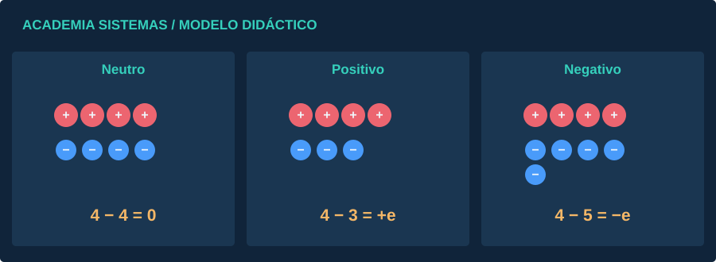

[← Anterior](04.md) · [Índice](../README.md) · [Siguiente →](06.md)

**LECCIÓN 001 · PÁGINA 5 DE 17**

# Carga neutra, positiva y negativa

> Contar antes de memorizar

*Figura 5. Representación esquemática; tamaños y posiciones no están a escala.*

## 1. Neutra

Las cargas se compensan. Un modelo con 4 cargas positivas y 4 negativas tiene carga neta cero, aunque contiene partículas cargadas.

## 2. Positiva

Si ese modelo pierde un electrón, quedan 4 positivas y 3 negativas. Hay déficit de electrones; no aparecen protones nuevos.

## 3. Negativa

Si el modelo neutro gana un electrón, quedan 4 positivas y 5 negativas. Hay exceso de electrones. El electrón proviene de otro sistema.

> [!TIP]
> **Ejemplo explicado:** Q = (Np − Ne)e. La magnitud e = 1,602 176 634 × 10⁻¹⁹ C. Para un átomo, un déficit de electrones produce un catión y un exceso puede producir un anión si el estado es estable.

### Comprueba lo aprendido

Calcula Q/e para 8p/8e, 11p/10e y 17p/18e. ¿Qué sucede con Q si el cuerpo pierde un electrón pero ya era negativo?

---

[← Anterior](04.md) · [Índice](../README.md) · [Siguiente →](06.md)
