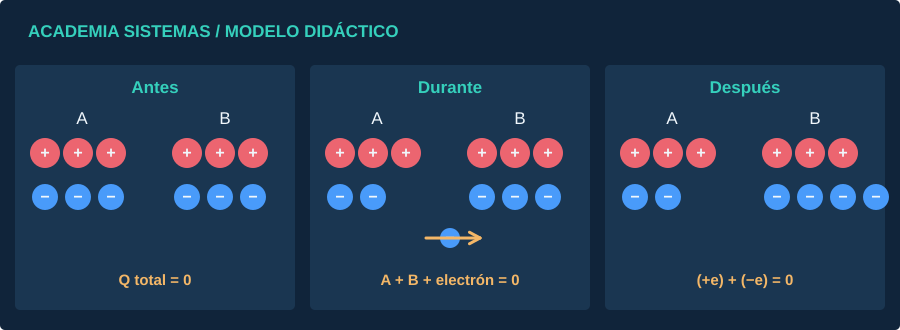
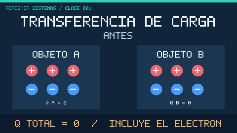

[← Anterior](05.md) · [Índice](../README.md) · [Siguiente →](07.md)

**LECCIÓN 001 · PÁGINA 6 DE 17**

# Transferencia y conservación

> Sigue el electrón desde el origen al destino

*Figura 6. Representación esquemática; tamaños y posiciones no están a escala.*

## 1. Antes

A y B empiezan neutros: 3 positivas y 3 negativas en cada uno. La suma de sus cargas es cero.

## 2. Durante

Una interacción permite que un electrón salga de A y vaya hacia B. Mientras está en tránsito, debe contarse también su carga −e.

## 3. Después

A conserva 3 positivas y 2 negativas: +e. B queda con 3 positivas y 4 negativas: −e. El sistema completo sigue teniendo carga neta cero.

## Observa el movimiento

*Animación cíclica de un modelo idealizado. El reinicio vuelve al estado inicial.*

> [!TIP]
> **Ejemplo explicado:** Si se transfieren 5 electrones de A a B inicialmente neutros: A = +5e y B = −5e; suma = 0. La energía puede cambiar de forma, pero la carga total se conserva en el sistema aislado.

### Comprueba lo aprendido

Dibuja dos objetos neutros. Transfiere tres electrones y luego devuelve uno. Calcula ambos signos en cada etapa.

---

[← Anterior](05.md) · [Índice](../README.md) · [Siguiente →](07.md)
