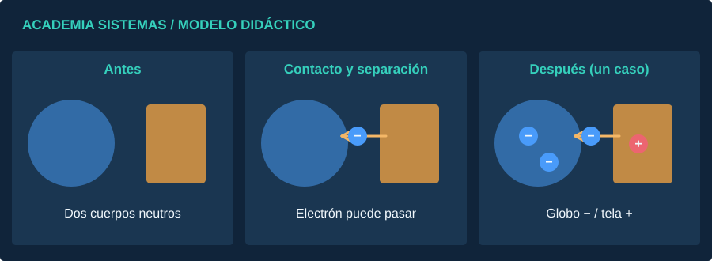
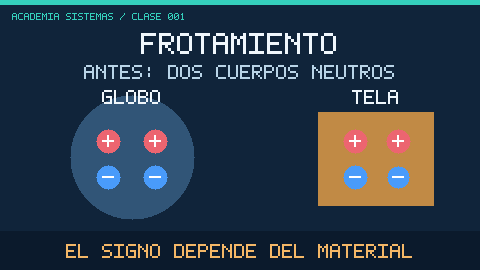

[← Anterior](07.md) · [Índice](../README.md) · [Siguiente →](09.md)

**LECCIÓN 001 · PÁGINA 8 DE 17**

# Electrización por frotamiento

> ¿Qué hace realmente la fricción?

*Figura 8. Representación esquemática; tamaños y posiciones no están a escala.*

## 1. Antes

Globo y tela pueden estar inicialmente neutros. Sus materiales tienen distintos estados y afinidades para las cargas en sus superficies.

## 2. Contacto repetido

Frotar aumenta los contactos y separaciones microscópicas; algunos electrones pueden quedar en el otro material. El trabajo mecánico facilita separar las cargas. El mecanismo detallado depende de la superficie.

## 3. Separación

En un caso típico, electrones pasan de una tela al globo: tela positiva, globo negativo. No siempre se obtiene el mismo signo; depende de materiales, humedad y condiciones.

## Observa el movimiento

*Animación cíclica de un modelo idealizado. El reinicio vuelve al estado inicial.*

> [!TIP]
> **Ejemplo explicado:** Una transferencia de 10 electrones del paño al globo deja +10e en el paño y −10e en el globo, si ambos eran neutros y se aíslan del entorno.

### Comprueba lo aprendido

Predice cómo cambia el resultado con una tela distinta. La prueba del papel no determina por sí sola el signo de la carga.

---

[← Anterior](07.md) · [Índice](../README.md) · [Siguiente →](09.md)
