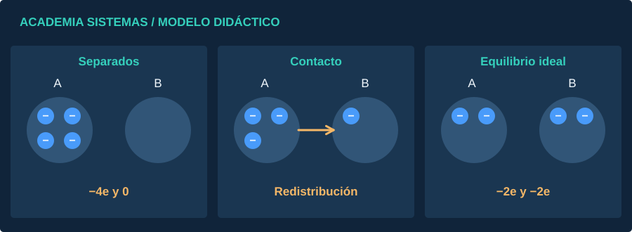

[← Anterior](08.md) · [Índice](../README.md) · [Siguiente →](10.md)

**LECCIÓN 001 · PÁGINA 9 DE 17**

# Electrización por contacto

> ¿Por qué se redistribuye la carga?

*Figura 9. Representación esquemática; tamaños y posiciones no están a escala.*

## 1. Separados

Dos conductores pueden tener diferente potencial eléctrico. Supón esferas idénticas, aisladas, con −4e y 0.

## 2. Contacto

Al unirlos, los electrones móviles se redistribuyen por el campo eléctrico hasta el equilibrio electrostático. No se transfieren protones entre los sólidos.

## 3. Equilibrio

Al separarlas, el modelo ideal da −2e en cada esfera. El reparto igual requiere simetría; no es una regla universal para cualquier geometría.

> [!TIP]
> **Ejemplo explicado:** Carga total inicial −4e + 0 = −4e. Final −2e −2e = −4e. Si las esferas son iguales y tienen +6e y −2e, el reparto ideal es +2e en cada una.

### Comprueba lo aprendido

¿En qué sentido neto se desplazan electrones si una esfera es positiva y otra negativa?

---

[← Anterior](08.md) · [Índice](../README.md) · [Siguiente →](10.md)
