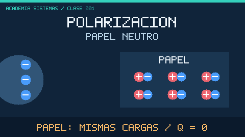

[← Anterior](09.md) · [Índice](../README.md) · [Siguiente →](11.md)

**LECCIÓN 001 · PÁGINA 10 DE 17**

# Polarización: atraer sin tocar

> ¿Por qué un globo atrae papel neutro?

*Figura 10. Representación esquemática; tamaños y posiciones no están a escala.*

## 1. Papel neutro

El papel contiene cargas positivas y negativas compensadas. Muchas cargas están ligadas en moléculas.

## 2. Globo cercano

El campo de un globo negativo desplaza ligeramente la distribución electrónica dentro del papel o reorienta dipolos. El lado próximo presenta carga positiva relativa.

## 3. Atracción

La atracción de las cargas opuestas más cercanas puede superar la repulsión de las negativas más alejadas. La carga neta del papel puede seguir siendo cero; no necesita recibir electrones del globo.

## Observa el movimiento

*Animación cíclica de un modelo idealizado. El reinicio vuelve al estado inicial.*

> [!TIP]
> **Ejemplo explicado:** La atracción de un papel no prueba que esté cargado positivamente. También ocurre con cuerpos neutros polarizables.

### Comprueba lo aprendido

Dibuja cuatro pares +/− dentro del papel antes y después. Conserva exactamente las mismas cargas.

---

[← Anterior](09.md) · [Índice](../README.md) · [Siguiente →](11.md)
