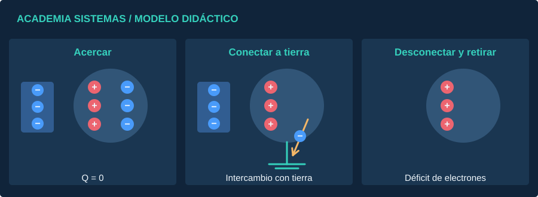

[← Anterior](10.md) · [Índice](../README.md) · [Siguiente →](12.md)

**LECCIÓN 001 · PÁGINA 11 DE 17**

# Inducción con conexión a tierra

> Cargar un conductor sin tocarlo con el inductor

*Figura 11. Representación esquemática; tamaños y posiciones no están a escala.*

## 1. Acercar

Una varilla negativa cerca de un conductor neutro redistribuye sus electrones. Aún no cambia su carga total.

## 2. Conectar a tierra

En un modelo electrostático, la repulsión permite que salgan electrones hacia tierra. La Tierra actúa como reservorio de carga.

## 3. Desconectar y retirar

Primero se retira la conexión a tierra y luego la varilla. El conductor queda con déficit de electrones. El balance se conserva al incluir la Tierra.

> [!TIP]
> **Ejemplo explicado:** No confundir polarización sola (Q del cuerpo no cambia) con inducción que incluye intercambio de carga con tierra. Esta secuencia es conceptual, no una instrucción para usar la red.

### Comprueba lo aprendido

Ordena los pasos y explica qué ocurriría si no hubiera camino para que salieran electrones. No conectar nada a un tomacorriente.

---

[← Anterior](10.md) · [Índice](../README.md) · [Siguiente →](12.md)
