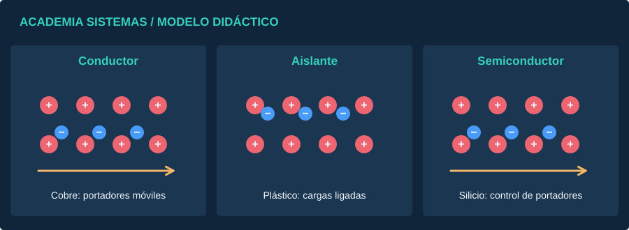

[← Anterior](11.md) · [Índice](../README.md) · [Siguiente →](13.md)

**LECCIÓN 001 · PÁGINA 12 DE 17**

# Conductores, aislantes y semiconductores

> No es lo mismo tener carga que poder transportarla

*Figura 12. Representación esquemática; tamaños y posiciones no están a escala.*

## 1. Conductor

En cobre y otros metales existen estados electrónicos que permiten transportar carga; los iones de la red no recorren el cable.

## 2. Aislante

En plástico o vidrio las cargas están mucho menos disponibles para el transporte en condiciones ordinarias. Pueden polarizarse o acumular carga localizada.

## 3. Semiconductor

En silicio la población y movilidad de portadores pueden controlarse mediante dopaje, temperatura, luz o campos. Eso permite dispositivos electrónicos.

> [!TIP]
> **Ejemplo explicado:** Un cable de cobre neutro puede conducir corriente. Un globo con carga negativa puede ser aislante. La carga neta y la conductividad son conceptos distintos.

### Comprueba lo aprendido

Identifica en un cable y un chip dónde hay conductor, aislante y semiconductor. No desmontes equipos energizados.

---

[← Anterior](11.md) · [Índice](../README.md) · [Siguiente →](13.md)
