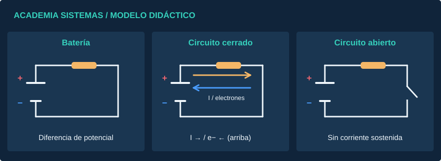
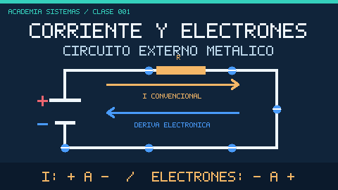

[← Anterior](12.md) · [Índice](../README.md) · [Siguiente →](14.md)

**LECCIÓN 001 · PÁGINA 13 DE 17**

# Corriente eléctrica y batería

> De la carga estática al transporte sostenido

*Figura 13. Representación esquemática; tamaños y posiciones no están a escala.*

## 1. Campo eléctrico

En un metal sin campo aplicado, el movimiento microscópico no tiene deriva neta. Una batería mantiene diferencia de potencial mediante procesos químicos.

## 2. Circuito cerrado

El campo eléctrico se establece en el circuito y los electrones adquieren deriva promedio. En el tramo superior del ejemplo salen convencionalmente del + hacia la resistencia; los electrones derivan en sentido contrario.

## 3. Circuito abierto

Sin camino cerrado no hay corriente sostenida. La corriente I = ΔQ/Δt mide carga que cruza una sección por tiempo. 1 A = 1 C/s. La resistencia transfiere energía, no consume electrones.

## Observa el movimiento

*Animación cíclica de un modelo idealizado. El reinicio vuelve al estado inicial.*

> [!TIP]
> **Ejemplo explicado:** En un circuito externo metálico de batería: corriente convencional del + al −; deriva electrónica del − al +. La propagación de la señal es mucho más rápida que la deriva individual.

### Comprueba lo aprendido

Dibuja la batería, resistencia e interruptor. Señala ambos sentidos en el mismo tramo y predice qué pasa al abrir el interruptor.

---

[← Anterior](12.md) · [Índice](../README.md) · [Siguiente →](14.md)
