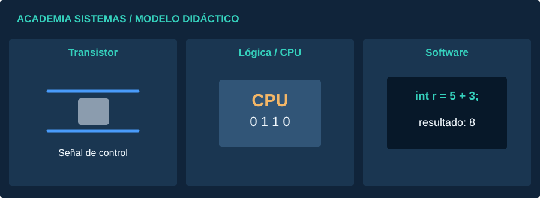

[← Anterior](13.md) · [Índice](../README.md) · [Siguiente →](15.md)

**LECCIÓN 001 · PÁGINA 14 DE 17**

# Del electrón al software

> Cómo se conectan las piezas de la ingeniería

*Figura 14. Representación esquemática; tamaños y posiciones no están a escala.*

## 1. Transistor

El control del transporte de carga en materiales semiconductores permite fabricar transistores, componentes capaces de controlar señales.

## 2. Lógica y procesador

Combinaciones de transistores forman compuertas. Los circuitos digitales interpretan rangos de señal como 0 y 1. Registros, ALU y memoria permiten procesar y almacenar datos.

## 3. Programa

El software expresa instrucciones y algoritmos. Según el lenguaje y entorno, estos se traducen o interpretan y terminan siendo ejecutados por hardware. Un bit no es un electrón individual.

> [!TIP]
> **Ejemplo explicado:** Una suma 5 + 3 en Java acaba relacionándose con operaciones de máquina, aunque el compilador y la JVM pueden optimizar cómo se ejecuta.

### Comprueba lo aprendido

Explica el camino átomo → semiconductor → transistor → compuerta → CPU → programa, sin memorizar palabras aisladas.

---

[← Anterior](13.md) · [Índice](../README.md) · [Siguiente →](15.md)
