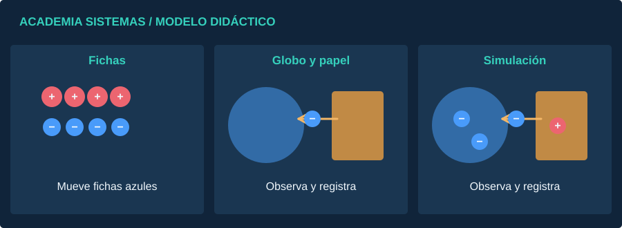

[← Anterior](14.md) · [Índice](../README.md) · [Siguiente →](16.md)

**LECCIÓN 001 · PÁGINA 15 DE 17**

# Laboratorio guiado: globo y fichas

> Comprobar, no solo observar

*Figura 15. Representación esquemática; tamaños y posiciones no están a escala.*

## 1. Fichas

Usa dos hojas A y B con 6 fichas rojas y 6 azules en cada una. Mueve una azul de A a B, luego dos más y devuelve dos. Registra cantidades y cargas en cada paso.

## 2. Globo y papel

Materiales: globo, tela seca, trozos de papel y regla. Acerca sin frotar y registra; frota 10 segundos; acerca a distancia comparable; repite tres veces.

## 3. Simulación

Abre PhET Globos y electricidad estática. Muestra todas las cargas, frota el globo contra el jersey y acércalo a la pared. Dibuja antes y después; observa polarización.

> [!TIP]
> **Ejemplo explicado:** No deduzcas el signo del globo solo porque atrae papel. Registra humedad, distancia y resultados; una ausencia de atracción también es un resultado válido. Mantén globos cargados lejos de electrónica sensible y líquidos inflamables. No uses red eléctrica.

### Comprueba lo aprendido

Entrega hipótesis, tabla de resultados, dibujos, explicación, limitaciones y conclusión. Usa la plantilla de laboratorio.

---

[← Anterior](14.md) · [Índice](../README.md) · [Siguiente →](16.md)
