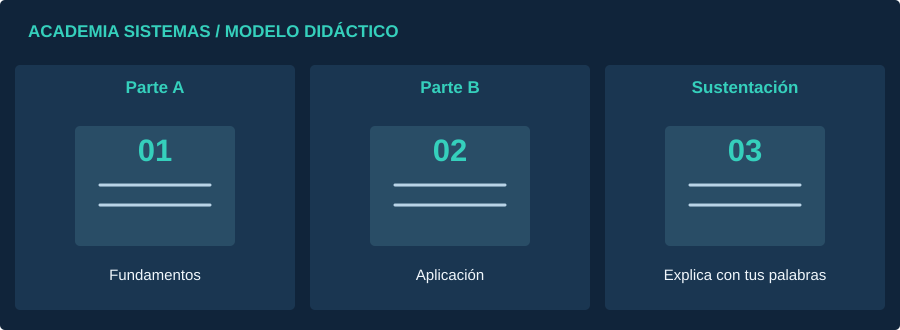

[← Anterior](16.md) · [Índice](../README.md) · [Descargas y cierre](../descargas.md)

**LECCIÓN 001 · PÁGINA 17 DE 17**

# Evaluación y sustentación

> Demuestra que puedes explicar el porqué

*Figura 17. Representación esquemática; tamaños y posiciones no están a escala.*

## 1. Parte A · 40 puntos

1) Define átomo y elemento (8). 2) Identifica cargas y ubicación de las partículas (8). 3) Calcula Q/e en 8p/8e, 11p/10e, 17p/18e y 6p/4e (8). 4) Justifica por qué sale un electrón y no un neutrón (8). 5) Dibuja fuerzas y efecto de duplicar distancia (8).

## 2. Parte B · 60 puntos

6) A y B neutros; A cede 4e: balance (15). 7) Compara frotamiento, contacto y polarización (15). 8) Clasifica materiales con ejemplos (10). 9) Dibuja circuito y sentidos (10). 10) Explica la relación con CPU y software (10).

## 3. Sustentación

Sin leer, explica qué energía permite transferir electrones, qué cambia al perder un protón o neutrón, y por qué la carga se conserva. Meta: 80/100 y dominio de estos conceptos.

> [!TIP]
> **Ejemplo explicado:** El examen es individual y dura aproximadamente 40 minutos adicionales. La ilustración del examen es una referencia de contexto, no contiene las respuestas. Los resultados personales no deben subirse a este repositorio público.

### Comprueba lo aprendido

Descarga la prueba y la plantilla de seguimiento. El docente puede solicitar una reevaluación de los conceptos no dominados.

---

[← Anterior](16.md) · [Índice](../README.md) · [Descargas y cierre](../descargas.md)

[Continuar a la clase 002 · Fuerzas eléctricas y campo →](../../002-carga-electricidad-energia/README.md)
