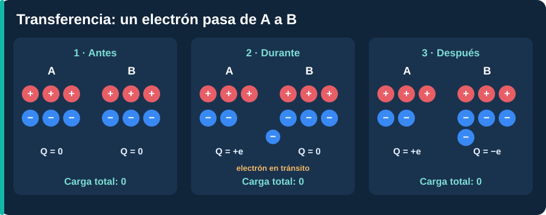
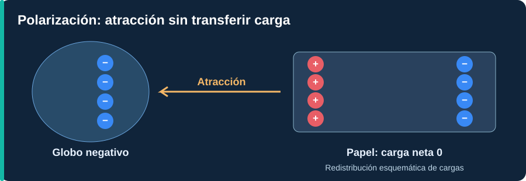

[Inicio](../../../../../README.md) · [Capítulo 01](../../../README.md) · [Clase 001](../README.md)

# Laboratorios ampliados

> Laboratorios · [Versión PDF](01-laboratorios.pdf)

---

## Práctica 1. Modelo de transferencia

Tiempo: 15 min. Materiales: 12 fichas rojas (+), 12 azules (-), dos hojas rotuladas A y B. No usar electricidad.

1. Pon 6 rojas y 6 azules en cada hoja. Predice la carga de cada una. 2. Mueve una azul de A a B. Cuenta cada grupo. 3. Mueve dos más de A a B. 4. Devuelve dos de B a A.

Registra para cada etapa: protones representados, electrones representados, carga A, carga B, total. No mover fichas rojas: representan cargas positivas ligadas al sólido.

Explica el resultado: las cargas no aparecen ni desaparecen del conjunto. El modelo no representa la geometría microscópica real.

Producto: tabla y dibujo del antes, durante y después. Rúbrica: conteo 30, balance 30, explicación 30, claridad 10.

## Práctica 2. Globo y papel

Tiempo: 20 min. Materiales: globo, tela seca, papel recortado y regla. Mantener lejos de electrónica sensible, líquidos inflamables y tomacorrientes. No provocar chispas deliberadamente.

Hipótesis: al frotar el globo, aumentará la atracción del papel. Control: globo sin frotar, papel del mismo tamaño y distancia comparable.

1. Acerca el globo sin tocar el papel y registra. 2. Frota la tela durante 10 segundos. 3. Repite a la misma distancia. 4. Haz tres ensayos. 5. Compara resultados. Si no funciona, cambia tela o busca un lugar seco.

Tabla: ensayo | distancia aproximada | antes | después | observaciones. Registrar si se mueve el papel y cuánto. No afirmar que se midió carga ni signo.

Análisis: el globo puede transferir electrones con la tela; el papel se polariza. La atracción no prueba su carga neta ni el signo del globo. La humedad puede facilitar disipación.

Rúbrica: procedimiento 25, registro 25, explicación 40, seguridad 10.

## Práctica 3. Simulación y reflexión

Tiempo: 20 min adicionales de trabajo autónomo. Abre la simulación PhET Globos y electricidad estática en español desde el enlace del repositorio.

1. Muestra todas las cargas. Cuenta o compara visualmente las cargas del globo y del jersey. 2. Frota el globo contra el jersey. 3. Observa qué partículas cambian de objeto. 4. Acerca el globo a la pared. 5. Predice qué pasa con un segundo globo cargado de igual signo.

Registra tres capturas o dibujos: antes, después de frotar y cerca de la pared. Escribe una explicación para cada uno.

Pregunta crítica: ¿por qué la pared atrae al globo aunque conserve neutralidad? ¿Qué simplificaciones tiene el modelo? ¿Qué diferencia existe entre la simulación y el laboratorio real?

Entrega: informe con objetivo, hipótesis, procedimiento, resultados, explicación, limitaciones y conclusión. No incluir información personal en un repositorio público.

Recurso: https://phet.colorado.edu/es/simulations/balloons-and-static-electricity/about

---

ACADEMIA SISTEMAS · [Volver a la lección](../README.md)
