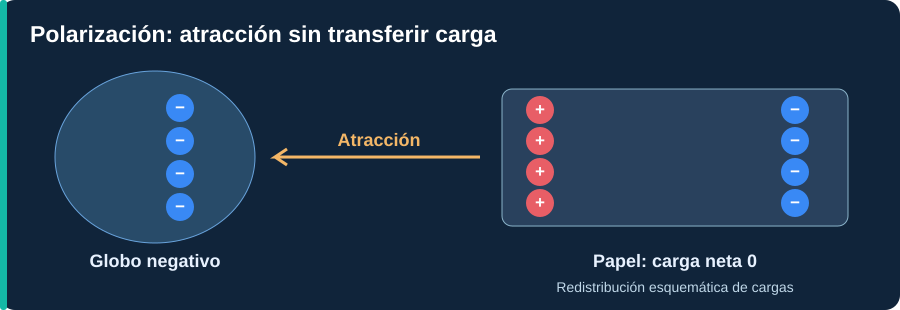

[Inicio](../../../../../README.md) · [Capítulo 01](../../../README.md) · [Clase 001](../README.md)

# Videos y simulaciones

> Recursos externos en español · Videos y simulación con preguntas guiadas

---

## Biblioteca audiovisual

| Recurso | Qué observar | Actividad posterior |
|---|---|---|
| 🎬 [Formas de electrizar un cuerpo — ANEP Uruguay](https://uruguayeduca.anep.edu.uy/sites/default/files/exelearning/06-2026/15503/formas_de_electrizar_un_cuerpo.html) | Frotamiento, contacto e inducción | Dibujar cada mecanismo y explicar si hay transferencia. |
| 🎬 [Conservación de la carga — Khan Academy](https://es.khanacademy.org/science/physics/electric-charge-electric-force-and-voltage/charge-electric-force/v/conservation-of-charge) | Balance de un sistema cerrado | Resolver un ejemplo sin mirar el resultado. |
| 🎬 [Efecto triboeléctrico y carga — Khan Academy](https://es.khanacademy.org/science/copiloto-fisica/copiloto2-electrosttica/v/triboelectric-effect-and-charge) | Interacción de materiales | Explicar por qué frotar no crea electrones. |
| 🧪 [Globos y electricidad estática — PhET](https://phet.colorado.edu/sims/html/balloons-and-static-electricity/latest/balloons-and-static-electricity_es.html) | Cargas del globo, jersey y pared | Ejecutar la práctica guiada 3. |
| 📚 [Actividades de electrostática — PhET](https://phet.colorado.edu/es_ES/activities/5583) | Material complementario | Elegir una pregunta de análisis adicional. |

> [!TIP]
> Pausa el video antes de la demostración y predice qué esperas observar. Después compara tu predicción con el resultado.

## Orden sugerido

1. Mira el primer video antes del laboratorio de globo.
2. Estudia el balance de carga y ve el segundo video.
3. Usa la simulación y responde la guía de práctica.
4. Consulta el tercer video para reforzar la electrización.

Enlaces localizados en páginas públicas. No se garantiza la reproducción futura y no se alojan copias de videos de terceros.

---

ACADEMIA SISTEMAS · [Volver a la lección](../README.md)
