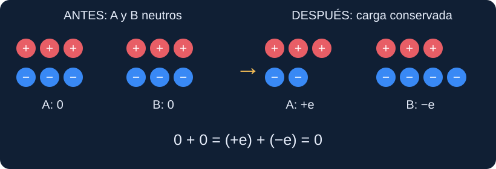

# Teoría — Materia, átomos, cargas y electrones

## Materia y estructura atómica
La materia ordinaria tiene masa y ocupa espacio. Está formada por átomos que pueden constituir moléculas o redes, como ocurre en los metales. Un átomo es la unidad de un elemento que conserva su identidad química. El núcleo contiene protones (+) y normalmente neutrones (0); los electrones (−) se describen por orbitales y distribuciones de probabilidad alrededor del núcleo, no como planetas en órbitas fijas.

## Carga eléctrica
Protón y electrón tienen la misma magnitud de carga elemental e ≈ 1,602 × 10⁻¹⁹ C, de signos opuestos. El neutrón tiene carga neta cero. Para un átomo o cuerpo con Np protones y Ne electrones, Q = (Np − Ne)e. Los núcleos no se trasladan de un objeto a otro durante la electrización ordinaria de sólidos.

| Protones | Electrones | Carga neta | Estado |
|---:|---:|---:|---|
| 4 | 4 | 0 | Neutro |
| 4 | 3 | +e | Positivo: déficit de electrones |
| 4 | 5 | −e | Negativo: exceso de electrones |

Un átomo que pierde electrones es un catión; si gana electrones, un anión. No todos los estados de carga son químicamente estables. Un objeto macroscópico cargado no es necesariamente un ion individual. Dos cargas del mismo signo se repelen; de signo opuesto se atraen.

## Transferencia y conservación
Si A y B comienzan neutros y un electrón pasa de A a B, A queda +e y B queda −e. La carga total antes y después es cero. En un sistema aislado la carga total se conserva. La transferencia no crea electrones nuevos.

- **Frotamiento:** el contacto y separación pueden transferir electrones según los materiales. Un globo frotado con tela suele quedar negativo en determinadas combinaciones; no es universal.
- **Contacto:** al unir conductores con distinto potencial, las cargas se redistribuyen hasta alcanzar equilibrio electrostático. Dos esferas conductoras idénticas aisladas con carga total −2e idealmente terminan con −e cada una; geometrías diferentes no garantizan reparto igual.
- **Polarización:** un cuerpo cargado puede redistribuir las cargas de uno neutro sin transferir electrones entre ellos. El papel sigue neutro y puede ser atraído por un globo cargado. Para cargar por inducción un conductor, se puede utilizar conexión a tierra y retirarla antes de alejar el inductor.

## Conductividad y corriente
En un metal hay electrones móviles; sin campo no hay deriva neta. Con campo eléctrico aparece una deriva promedio de electrones en sentido opuesto al campo. Los iones de la red metálica permanecen aproximadamente en sus posiciones. Los aislantes dificultan la movilidad de cargas; los semiconductores permiten controlar su conductividad (silicio, germanio).

Una pila mantiene una diferencia de potencial y un circuito cerrado permite corriente sostenida. En el circuito externo metálico, la corriente convencional va del positivo al negativo; la deriva de electrones va del negativo al positivo. La corriente es transporte de carga por unidad de tiempo; no se consume la carga en una resistencia, se transfiere energía. La propagación de la señal no equivale a la velocidad de deriva de un electrón.

## De la electrónica al software
Cargas y señales → transistores → compuertas lógicas → circuitos digitales → procesador → instrucciones de máquina → software. Esta relación se profundizará en los siguientes módulos.

## Repaso
Explica por qué perder electrones vuelve positivo un objeto, de dónde salen los electrones ganados, y cómo un objeto neutro puede ser atraído sin recibir electrones.
