# Teoría visual de la clase 001

[← Índice](README.md) · [Leer desde el principio →](libro/01.md)

## 01. De un cable al átomo

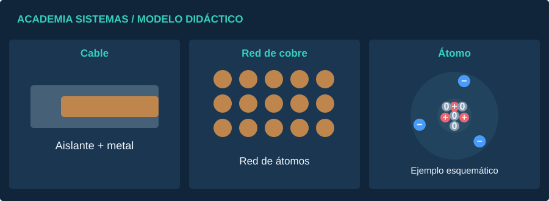

**Objeto:** Un cable real contiene un núcleo metálico y una cubierta aislante. Ambos son materia: tienen masa y ocupan espacio.

**Material:** Al ampliar el cobre aparecen átomos organizados en una red. No todo material está hecho de moléculas independientes.

**Átomo:** Un átomo de cobre tiene 29 protones. El número de protones define el elemento; los electrones permiten muchas de sus interacciones.

[Ejemplo y práctica →](libro/01.md)

## 02. Dentro del átomo

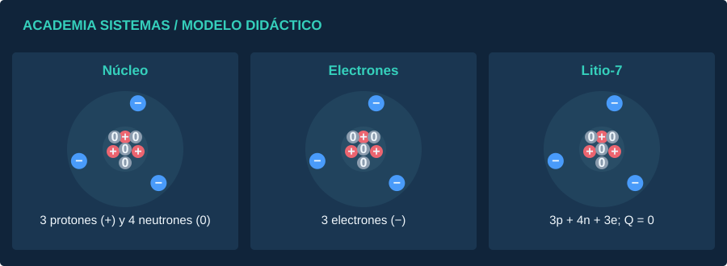

**Núcleo:** Contiene protones de carga +e y, normalmente, neutrones de carga cero. El hidrógeno-1 es una excepción: su núcleo solo tiene un protón.

**Región electrónica:** Los electrones tienen carga −e y se describen mediante estados cuánticos. Los dibujos de capas representan regiones, no trayectorias reales.

**Ejemplo: litio-7:** Tiene 3 protones, 4 neutrones y, si es neutro, 3 electrones. Los protones y neutrones concentran casi toda la masa.

[Ejemplo y práctica →](libro/02.md)

## 03. ¿Qué mantiene unido al electrón?

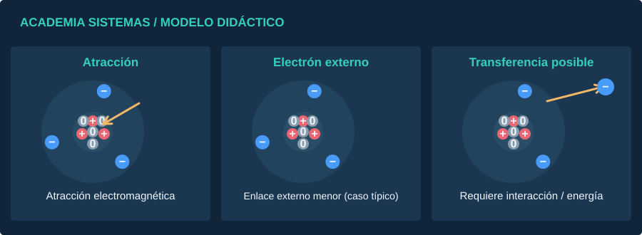

**Atracción:** El núcleo positivo atrae a los electrones negativos mediante la interacción electromagnética. Los electrones también se repelen entre sí.

**Apantallamiento:** En átomos con varios electrones, los internos reducen en parte la atracción efectiva sobre los externos. Algunos electrones de valencia están menos ligados; en sólidos importan también los enlaces y estados electrónicos.

**Aporte de energía:** Un electrón no sale porque sí. Una interacción con otro material, radiación, calor o un campo suficientemente intenso puede permitir que cambie de estado o se transfiera. Arrancarlo de un átomo aislado requiere energía de ionización.

[Ejemplo y práctica →](libro/03.md)

## 04. ¿Por qué no se mueve un protón o un neutrón?

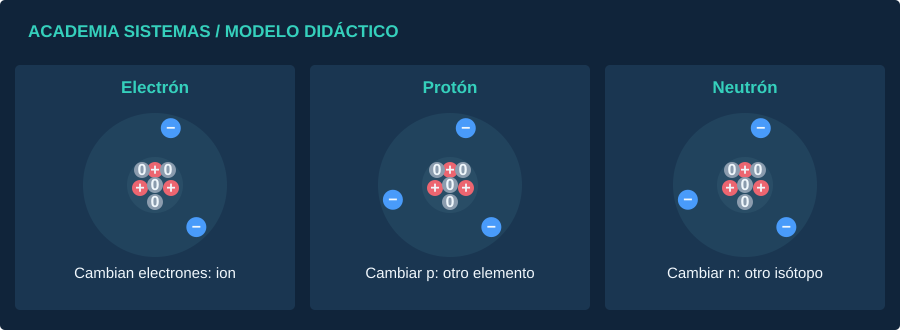

**Electrón:** Está ligado electromagnéticamente fuera del núcleo. En la electrización ordinaria de sólidos pueden redistribuirse algunos electrones, sin alterar los núcleos.

**Protón:** Está en el núcleo, ligado por interacciones nucleares. Cambiar el número de protones cambia el elemento: carbono tiene 6 y nitrógeno 7. Separar un protón es un proceso nuclear, no de frotamiento.

**Neutrón:** También está ligado en el núcleo y no tiene carga neta. Perder un neutrón cambia el isótopo, no la carga neta por sí solo. Un neutrón no contiene un electrón que se desprenda al frotar.

[Ejemplo y práctica →](libro/04.md)

## 05. Carga neutra, positiva y negativa

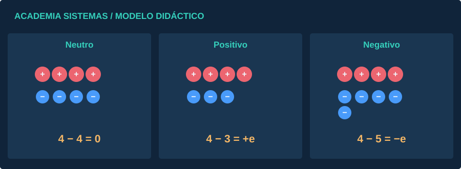

**Neutra:** Las cargas se compensan. Un modelo con 4 cargas positivas y 4 negativas tiene carga neta cero, aunque contiene partículas cargadas.

**Positiva:** Si ese modelo pierde un electrón, quedan 4 positivas y 3 negativas. Hay déficit de electrones; no aparecen protones nuevos.

**Negativa:** Si el modelo neutro gana un electrón, quedan 4 positivas y 5 negativas. Hay exceso de electrones. El electrón proviene de otro sistema.

[Ejemplo y práctica →](libro/05.md)

## 06. Transferencia y conservación

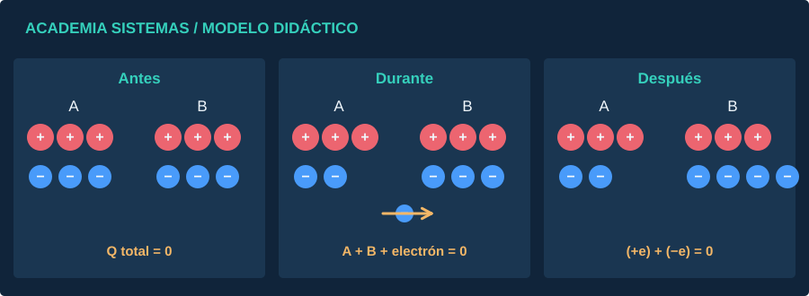

**Antes:** A y B empiezan neutros: 3 positivas y 3 negativas en cada uno. La suma de sus cargas es cero.

**Durante:** Una interacción permite que un electrón salga de A y vaya hacia B. Mientras está en tránsito, debe contarse también su carga −e.

**Después:** A conserva 3 positivas y 2 negativas: +e. B queda con 3 positivas y 4 negativas: −e. El sistema completo sigue teniendo carga neta cero.

[Ejemplo y práctica →](libro/06.md)

## 07. Atracción y repulsión

**Iguales positivas:** Dos cargas + se repelen. Las fuerzas sobre cada una tienen sentidos opuestos.

**Iguales negativas:** Dos cargas − también se repelen. Negativo no significa que no exista fuerza.

**Opuestas:** Una carga + y otra − se atraen. Para cargas puntuales en el vacío, F = k|q₁q₂|/r²: al duplicar la distancia, la magnitud queda en un cuarto.

[Ejemplo y práctica →](libro/07.md)

## 08. Electrización por frotamiento

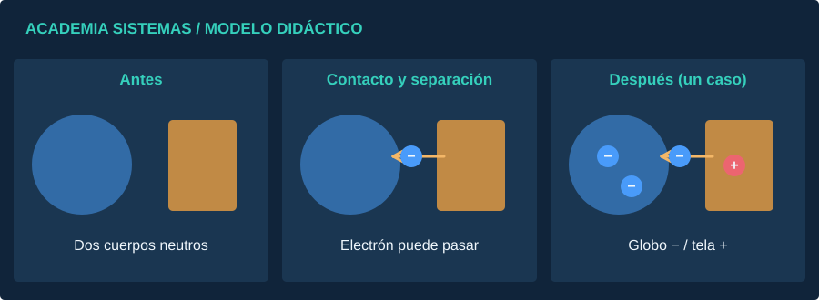

**Antes:** Globo y tela pueden estar inicialmente neutros. Sus materiales tienen distintos estados y afinidades para las cargas en sus superficies.

**Contacto repetido:** Frotar aumenta los contactos y separaciones microscópicas; algunos electrones pueden quedar en el otro material. El trabajo mecánico facilita separar las cargas. El mecanismo detallado depende de la superficie.

**Separación:** En un caso típico, electrones pasan de una tela al globo: tela positiva, globo negativo. No siempre se obtiene el mismo signo; depende de materiales, humedad y condiciones.

[Ejemplo y práctica →](libro/08.md)

## 09. Electrización por contacto

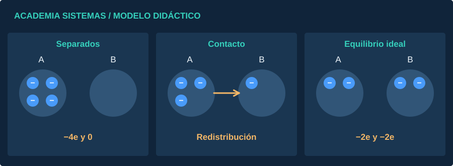

**Separados:** Dos conductores pueden tener diferente potencial eléctrico. Supón esferas idénticas, aisladas, con −4e y 0.

**Contacto:** Al unirlos, los electrones móviles se redistribuyen por el campo eléctrico hasta el equilibrio electrostático. No se transfieren protones entre los sólidos.

**Equilibrio:** Al separarlas, el modelo ideal da −2e en cada esfera. El reparto igual requiere simetría; no es una regla universal para cualquier geometría.

[Ejemplo y práctica →](libro/09.md)

## 10. Polarización: atraer sin tocar

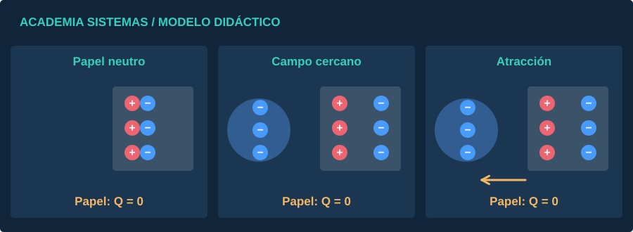

**Papel neutro:** El papel contiene cargas positivas y negativas compensadas. Muchas cargas están ligadas en moléculas.

**Globo cercano:** El campo de un globo negativo desplaza ligeramente la distribución electrónica dentro del papel o reorienta dipolos. El lado próximo presenta carga positiva relativa.

**Atracción:** La atracción de las cargas opuestas más cercanas puede superar la repulsión de las negativas más alejadas. La carga neta del papel puede seguir siendo cero; no necesita recibir electrones del globo.

[Ejemplo y práctica →](libro/10.md)

## 11. Inducción con conexión a tierra

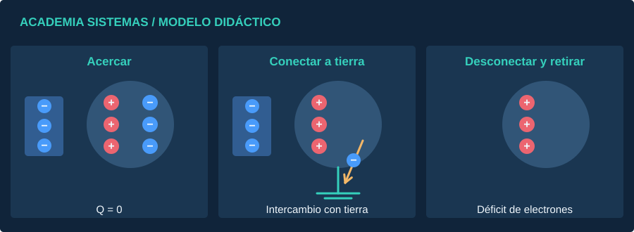

**Acercar:** Una varilla negativa cerca de un conductor neutro redistribuye sus electrones. Aún no cambia su carga total.

**Conectar a tierra:** En un modelo electrostático, la repulsión permite que salgan electrones hacia tierra. La Tierra actúa como reservorio de carga.

**Desconectar y retirar:** Primero se retira la conexión a tierra y luego la varilla. El conductor queda con déficit de electrones. El balance se conserva al incluir la Tierra.

[Ejemplo y práctica →](libro/11.md)

## 12. Conductores, aislantes y semiconductores

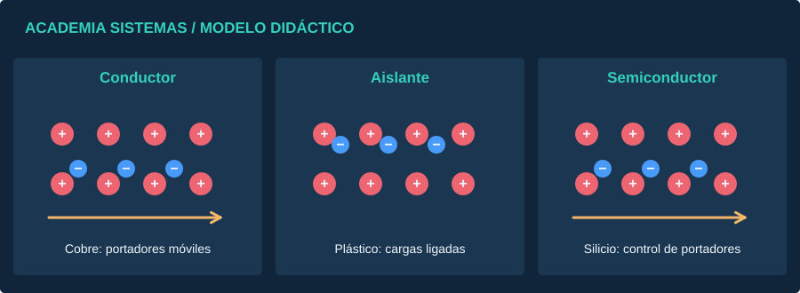

**Conductor:** En cobre y otros metales existen estados electrónicos que permiten transportar carga; los iones de la red no recorren el cable.

**Aislante:** En plástico o vidrio las cargas están mucho menos disponibles para el transporte en condiciones ordinarias. Pueden polarizarse o acumular carga localizada.

**Semiconductor:** En silicio la población y movilidad de portadores pueden controlarse mediante dopaje, temperatura, luz o campos. Eso permite dispositivos electrónicos.

[Ejemplo y práctica →](libro/12.md)

## 13. Corriente eléctrica y batería

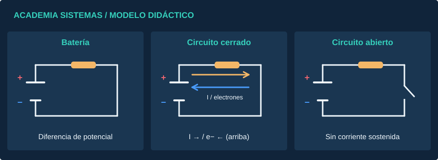

**Campo eléctrico:** En un metal sin campo aplicado, el movimiento microscópico no tiene deriva neta. Una batería mantiene diferencia de potencial mediante procesos químicos.

**Circuito cerrado:** El campo eléctrico se establece en el circuito y los electrones adquieren deriva promedio. En el tramo superior del ejemplo salen convencionalmente del + hacia la resistencia; los electrones derivan en sentido contrario.

**Circuito abierto:** Sin camino cerrado no hay corriente sostenida. La corriente I = ΔQ/Δt mide carga que cruza una sección por tiempo. 1 A = 1 C/s. La resistencia transfiere energía, no consume electrones.

[Ejemplo y práctica →](libro/13.md)

## 14. Del electrón al software

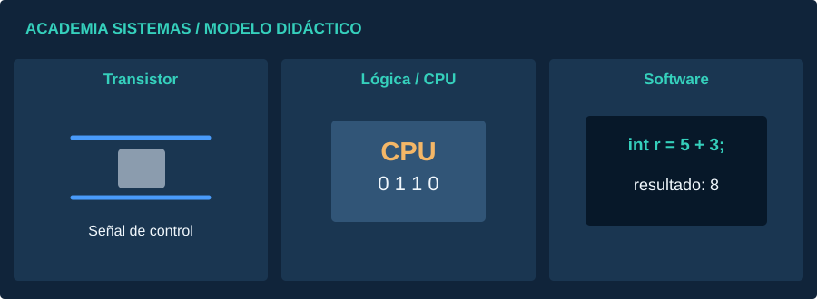

**Transistor:** El control del transporte de carga en materiales semiconductores permite fabricar transistores, componentes capaces de controlar señales.

**Lógica y procesador:** Combinaciones de transistores forman compuertas. Los circuitos digitales interpretan rangos de señal como 0 y 1. Registros, ALU y memoria permiten procesar y almacenar datos.

**Programa:** El software expresa instrucciones y algoritmos. Según el lenguaje y entorno, estos se traducen o interpretan y terminan siendo ejecutados por hardware. Un bit no es un electrón individual.

[Ejemplo y práctica →](libro/14.md)

[Ejercicios →](libro/16.md)
