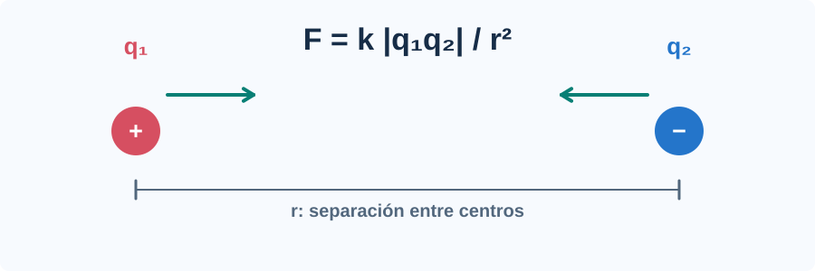

[← Clase 001](../001-materia-atomos-electrones/README.md) · [Índice del capítulo](../README.md) · [Clase 003 →](../003-energia-trabajo-conservacion/README.md)

# Clase 002 · Fuerzas eléctricas, campo y ley de Coulomb

**Nivel inicial · 14 temas ilustrados · 180 minutos + evaluación autónoma.**

[▶ Comenzar a leer](libro/01.md) · [Libro interactivo web](https://mangelmorenomoreno.github.io/academia-sistemas/modulos/01-electronica-basica/clases/002-carga-electricidad-energia/libro.html) · [Biblioteca y descargas](descargas.md)

> [!TIP]
> Primero predice, luego dibuja, calcula y comprueba. No avances hasta poder explicar por qué la fuerza cambia.

| Página | Tema |
|---|---|
| 01 | [¿Qué es una fuerza?](libro/01.md) |
| 02 | [¿Cómo actúan las cargas sin tocarse?](libro/02.md) |
| 03 | [Atracción, repulsión y acción-reacción](libro/03.md) |
| 04 | [Medir cargas y distancias](libro/04.md) |
| 05 | [Ley de Coulomb: ¿qué determina la fuerza?](libro/05.md) |
| 06 | [¿Por qué aparece la distancia al cuadrado?](libro/06.md) |
| 07 | [Coulomb paso a paso](libro/07.md) |
| 08 | [¿Qué es el campo eléctrico?](libro/08.md) |
| 09 | [Campo y fuerza no son lo mismo](libro/09.md) |
| 10 | [Leer un mapa de campo](libro/10.md) |
| 11 | [Superposición: varios campos a la vez](libro/11.md) |
| 12 | [Aplicaciones en ingeniería](libro/12.md) |
| 13 | [Laboratorio virtual: medir y predecir](libro/13.md) |
| 14 | [Comprueba tus fundamentos](libro/14.md) |

## Materiales

[Lectura ampliada](lecturas/guia-ampliada.md) · [Ejercicios](ejercicios/README.md) · [Laboratorio](practicas/README.md) · [Evaluación](pruebas/README.md) · [Soluciones](soluciones/README.md) · [Videos](recursos/videos-y-simulaciones.md) · [Guía docente](guia-docente.md)

[Simulador interactivo](https://mangelmorenomoreno.github.io/academia-sistemas/modulos/01-electronica-basica/clases/002-carga-electricidad-energia/simulador.html) (requiere GitHub Pages activo).

[Comenzar →](libro/01.md)
