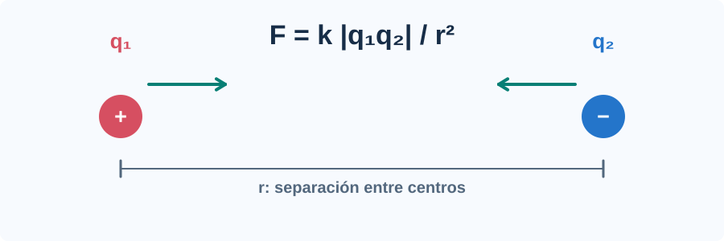

# Cuaderno de ejercicios

[← Índice](../README.md) · [PDF](02-ejercicios.pdf)

Usa k=9×10⁹. Escribe datos, conversiones, fórmula, resultado y dibujo.

### 01 · Vectores

Dos fuerzas de 7 N derecha y 4 N izquierda. Determina resultante.

### 02 · Signos

Dibuja fuerzas de +2 µC y −5 µC. ¿Son iguales en magnitud?

### 03 · Conversiones

Convierte 3 µC, −20 nC y 25 cm a SI.

### 04 · Coulomb

Calcula F para +1 µC y +4 µC a 30 cm.

### 05 · Coulomb

Calcula F para +2 µC y −3 µC a 20 cm.

### 06 · Distancia

Si F=18 N a 10 cm, calcula F a 30 cm.

### 07 · Proporciones

Triplica q₁ y duplica r. ¿En qué factor cambia F?

### 08 · Campo

Calcula E a 2 m de una carga fuente +2 µC.

### 09 · Fuerza de prueba

E=300 N/C derecha, q=−2 µC. Calcula F y sentido.

### 10 · Electrón

E=100 N/C derecha. Calcula fuerza sobre un electrón.

### 11 · Superposición

Dos +1 µC separadas 2 m: E en el centro. Repite con la derecha negativa.

### 12 · Análisis

¿Puede E ser cero aunque existan cargas? ¿La flecha E es una trayectoria?

### 13 · Modelo

Explica por qué r es separación entre centros y qué limitaciones tiene Coulomb.

### 14 · Ingeniería

Relaciona campo eléctrico, protección ESD y semiconductores sin confundir campo con corriente.
