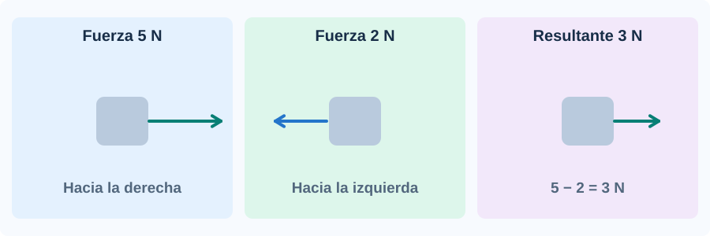
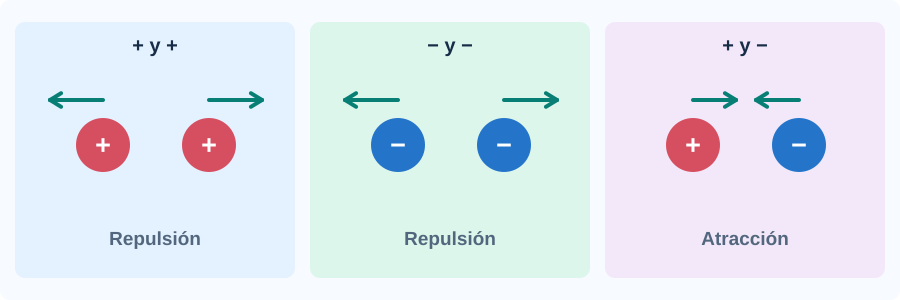
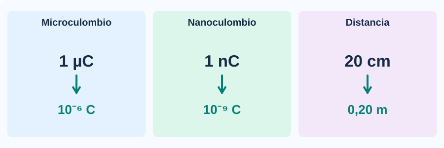
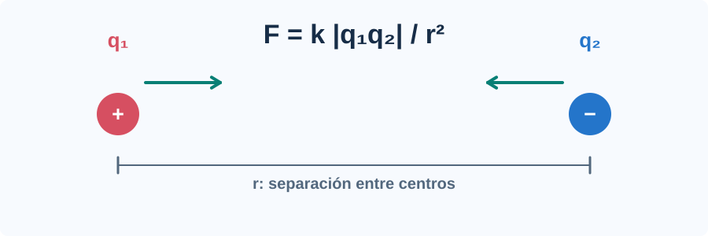
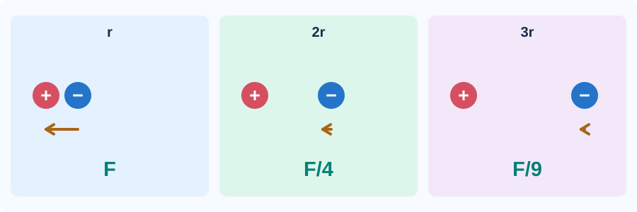
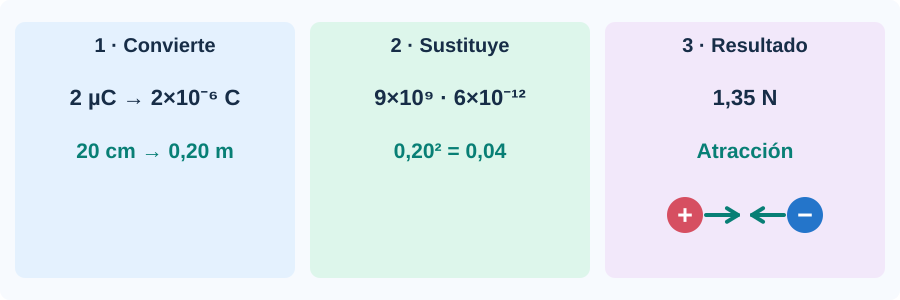
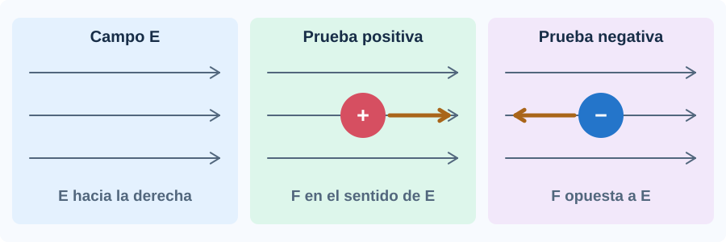
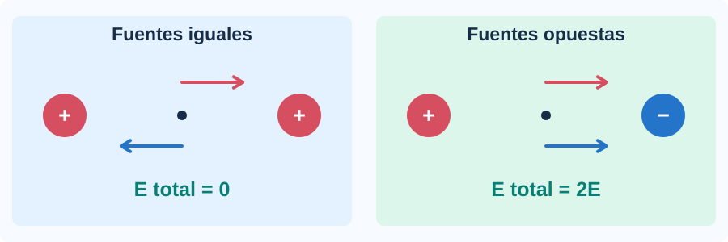
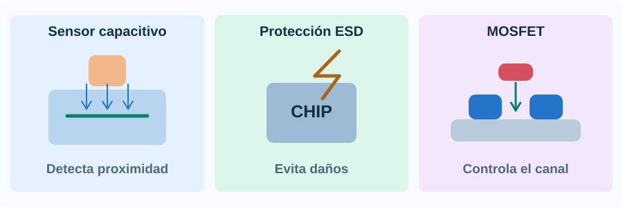
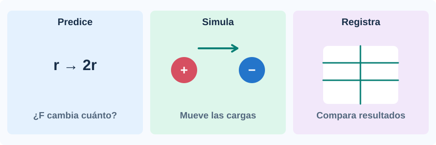

# Lectura ilustrada · Clase 002

[← Índice](../README.md) · [PDF](02-guia-de-estudio.pdf)

## 01 · ¿Qué es una fuerza?

Empujar una caja puede cambiar su velocidad o dirección. Una fuerza no es energía: se mide en newtons (N), mientras la energía se mide en julios (J).

Una fuerza tiene magnitud, dirección y sentido: es un vector. Una flecha más larga representa mayor magnitud si usamos la misma escala.

La fuerza resultante es la suma vectorial de todas las fuerzas. Si la resultante es cero, la aceleración es cero; no significa necesariamente que el objeto esté quieto.

**Ejemplo:** Una caja recibe 5 N hacia la derecha y 2 N hacia la izquierda: la fuerza resultante es 3 N hacia la derecha.

**Tu turno:** Dibuja 4 N hacia la izquierda y 7 N hacia la derecha. ¿Cuál es la resultante?

---

## 02 · ¿Cómo actúan las cargas sin tocarse?

En la clase anterior aprendiste que la carga es una propiedad de la materia. Una carga modifica el campo eléctrico en su entorno.

Otra carga situada en ese entorno experimenta una fuerza. Esto permite describir la interacción sin imaginar un hilo invisible ni electrones saltando entre los cuerpos.

En electrostática estudiamos cargas en reposo o configuraciones aproximadamente estacionarias. Los cambios del campo no se propagan instantáneamente; este modelo no estudia todavía la propagación electromagnética.

**Ejemplo:** Un globo cargado puede atraer papel neutro por polarización. No necesita tocarlo ni transferirle electrones.

**Tu turno:** ¿Una fuerza eléctrica requiere contacto? Explica usando el concepto de campo.

---

## 03 · Atracción, repulsión y acción-reacción

Dos cargas positivas se repelen. Dos negativas también. Una positiva y otra negativa se atraen.

Las fuerzas electrostáticas entre dos cargas puntuales tienen igual magnitud y sentidos opuestos, según la tercera ley de Newton en este modelo. Cada fuerza actúa sobre un cuerpo diferente.

Si las masas son distintas, pueden tener aceleraciones diferentes aunque las fuerzas tengan igual magnitud. Si están fijas, otras fuerzas las mantienen en su lugar.

**Ejemplo:** Una carga de +2 µC y una de −6 µC se atraen con fuerzas iguales en magnitud. No es correcto afirmar que la de −6 µC ejerce tres veces más fuerza sobre la otra.

**Tu turno:** Dibuja el par de fuerzas para +/+, −/− y +/−.

---

## 04 · Medir cargas y distancias

El culombio (C) mide carga. En electrostática son frecuentes el microculombio (µC = 10⁻⁶ C) y el nanoculombio (nC = 10⁻⁹ C).

La ley de Coulomb usa metros para la separación r entre centros de cargas puntuales. 1 cm = 0,01 m; 1 mm = 0,001 m.

La notación científica ayuda a multiplicar cantidades muy pequeñas. Al multiplicar potencias de diez se suman exponentes; al elevar una potencia al cuadrado se multiplica su exponente por dos.

**Ejemplo:** 2 µC = 2 × 10⁻⁶ C; 20 cm = 0,20 m; (0,20 m)² = 0,04 m².

**Tu turno:** Convierte −5 µC, 80 nC y 15 cm a unidades SI. Calcula (0,15)².

---

## 05 · Ley de Coulomb: ¿qué determina la fuerza?

Para dos cargas puntuales en reposo en el vacío: F = k |q₁q₂| / r². En aire se usa a menudo la misma aproximación. k ≈ 8,99 × 10⁹ N·m²/C²; en clase redondeamos a 9 × 10⁹.

F es la magnitud de la fuerza en N. q₁ y q₂ son las cargas en C; r es la separación en m. El valor absoluto evita que una magnitud sea negativa.

El sentido se determina por los signos y la línea que une las cargas. En otros medios, la permitividad puede modificar la interacción; la fórmula puntual no describe cualquier objeto extenso a cualquier distancia.

**Ejemplo:** Si duplicamos solo q₁, F se duplica. Si duplicamos ambas cargas, F se cuadruplica. Si duplicamos r, F queda en un cuarto.

**Tu turno:** ¿Qué ocurre con F si una carga se triplica y la distancia se duplica al mismo tiempo?

---

## 06 · ¿Por qué aparece la distancia al cuadrado?

Imagina esferas concéntricas centradas en una carga puntual. Su superficie es 4πr². Si duplicas el radio, el área se multiplica por cuatro.

En simetría esférica, el flujo eléctrico total a través de esas esferas permanece igual para una carga encerrada fija (ley de Gauss, que estudiaremos más adelante). Por eso el campo radial disminuye como 1/r².

Las líneas de campo son un dibujo para representar dirección y densidad relativa, no cuerdas físicas ni un número real de líneas. La explicación mediante superficie supone simetría esférica.

**Ejemplo:** A distancias r, 2r y 3r, las fuerzas relativas para las mismas cargas son 1, 1/4 y 1/9.

**Tu turno:** Si a 10 cm la fuerza es 18 N, ¿cuánto sería a 30 cm?

---

## 07 · Coulomb paso a paso

Datos: q₁ = +2 µC, q₂ = −3 µC, r = 20 cm. Son opuestas, por tanto se atraen. Convierte a 2×10⁻⁶ C, −3×10⁻⁶ C y 0,20 m.

Multiplica magnitudes: |q₁q₂| = 6×10⁻¹² C². Eleva distancia: r² = 0,04 m². Multiplica por k: 9×10⁹ × 6×10⁻¹² = 0,054 N·m².

Divide 0,054 entre 0,04: F = 1,35 N. Dibuja fuerzas iguales que apuntan una hacia la otra. Las unidades C² y m² se cancelan y queda N.

**Ejemplo:** Si r pasa de 0,20 a 0,40 m, F = 1,35/4 = 0,3375 N. El signo de atracción no cambia.

**Tu turno:** Resuelve +1 µC y +4 µC a 30 cm. Incluye dibujo, unidades y sentido.

---

## 08 · ¿Qué es el campo eléctrico?

Para medir el efecto eléctrico de una carga fuente Q, imaginamos una carga de prueba positiva q₀ muy pequeña, de modo que no altere significativamente la distribución original.

El campo en un punto se define como E = F/q₀ (límite de carga de prueba pequeña). Su unidad es N/C. El campo existe en el modelo aunque no coloquemos la carga de prueba.

Para una carga puntual Q: |E| = k|Q|/r². El campo sale radialmente de Q positiva y entra hacia Q negativa. No es la fuerza: la fuerza depende también de la carga que coloquemos.

**Ejemplo:** Una fuente +2 µC produce E = 4.500 N/C a 2 m; el campo apunta alejándose de la fuente.

**Tu turno:** ¿Cambia el campo de la fuente si duplicas una carga de prueba ideal? ¿Cambia la fuerza?

---

## 09 · Campo y fuerza no son lo mismo

Si colocamos una carga positiva en un campo eléctrico, la fuerza tiene el mismo sentido del campo. Si colocamos una negativa, el sentido se invierte.

Un electrón tiene carga −e ≈ −1,602×10⁻¹⁹ C. En un campo de 100 N/C hacia la derecha, su fuerza eléctrica apunta a la izquierda.

La magnitud es |q|E. Para el electrón del ejemplo, F = 1,602×10⁻¹⁷ N. Su movimiento real depende además de su velocidad inicial y de otras fuerzas; una flecha de fuerza no es necesariamente una trayectoria.

**Ejemplo:** Con E = 300 N/C hacia la derecha, una carga −2 µC siente 0,0006 N hacia la izquierda.

**Tu turno:** Dibuja E hacia arriba y fuerzas sobre +3 µC y −3 µC. ¿Cuál es mayor en magnitud?

---

## 10 · Leer un mapa de campo

Las líneas electrostáticas salen de cargas positivas y terminan en negativas o en el infinito; también pueden venir del infinito hacia una carga negativa.

La tangente a una línea indica la dirección de E. Las líneas no se cruzan en puntos donde E tiene dirección definida. Una mayor densidad relativa sugiere mayor magnitud en diagramas comparables.

Entre placas paralelas grandes y con cargas opuestas, lejos de los bordes, el campo puede aproximarse como uniforme. Esto anticipa el estudio de voltaje y condensadores.

**Ejemplo:** En un campo uniforme las flechas son paralelas y de igual longitud. No ocurre así alrededor de una carga puntual aislada.

**Tu turno:** Compara una carga positiva, una negativa y dos placas. Marca el sentido de E.

---

## 11 · Superposición: varios campos a la vez

El campo total en un punto es la suma vectorial de los campos individuales. Calcula cada aporte antes de sumar; no sumes magnitudes sin mirar sentidos.

En el punto medio entre dos cargas positivas iguales, ambos campos tienen igual magnitud y sentidos opuestos: E total = 0. Las cargas fuente no desaparecen.

En el punto medio entre +Q y −Q iguales, ambos campos apuntan hacia la negativa: se suman. Si las direcciones no son colineales, se suman componentes x e y.

**Ejemplo:** Dos cargas +1 µC separadas 2 m: en el centro cada campo vale 9.000 N/C, pero se cancelan. Si la derecha fuera −1 µC, E total = 18.000 N/C hacia la derecha.

**Tu turno:** Dibuja dos cargas positivas iguales y coloca el punto de prueba más cerca de la izquierda. ¿Hacia dónde apunta E total?

---

## 12 · Aplicaciones en ingeniería

Una pantalla táctil capacitiva detecta cambios de capacitancia asociados a la proximidad del dedo; el campo eléctrico participa en el fenómeno. No es necesario que se transfieran electrones al vidrio.

Una descarga electrostática (ESD) puede dañar componentes semiconductores: una diferencia de potencial puede producir un pulso de corriente. Por eso se usan medidas de protección ESD.

En transistores MOSFET, un campo eléctrico asociado a la puerta controla las condiciones de conducción del canal. Comprender campo eléctrico ayuda a entender este mecanismo más adelante.

**Ejemplo:** La electrostática explica parte del funcionamiento de sensores y la necesidad de proteger circuitos, pero no sustituye el estudio de corriente, energía y semiconductores.

**Tu turno:** Busca un ejemplo de sensor capacitivo y explica qué propiedad se detecta. No provoques descargas en equipos.

---

## 13 · Laboratorio virtual: medir y predecir

Usa el simulador integrado o PhET. Mantén q₁ y q₂ fijas, registra la fuerza a r = 10, 20 y 30 cm. Antes de cambiar r, predice la relación.

Cambia el signo de q₂ conservando su magnitud. Observa cómo cambia el sentido pero no la magnitud. Luego duplica únicamente q₁.

En PhET Cargas y campos, coloca una fuente positiva, mueve el sensor y observa dirección y magnitud. Compara el campo de dos fuentes iguales y opuestas en su punto medio.

**Ejemplo:** Registra columnas q₁, q₂, r, F predicha, F observada, sentido y error relativo. En el simulador local los datos son calculados, no mediciones independientes.

**Tu turno:** Entrega tres dibujos, tabla de resultados y conclusión. No conectar nada a la red eléctrica.

---

## 14 · Comprueba tus fundamentos

Distingue carga, fuerza y campo con sus unidades. Explica por qué una carga negativa siente una fuerza opuesta a E.

Resuelve un problema de Coulomb con conversiones y otro de superposición. Comprueba qué ocurre al duplicar la distancia.

Explica qué condiciones supone el modelo de cargas puntuales y por qué no es correcto decir que las líneas son objetos físicos.

**Ejemplo:** Meta: 80/100 y dominio de signos, unidades, vectores y relación inversa al cuadrado. Si quedan dudas, repite las páginas correspondientes.

**Tu turno:** Presenta la prueba sin apuntes y sustenta tus respuestas. Sigue a clase 003: energía, trabajo y conservación.

---
