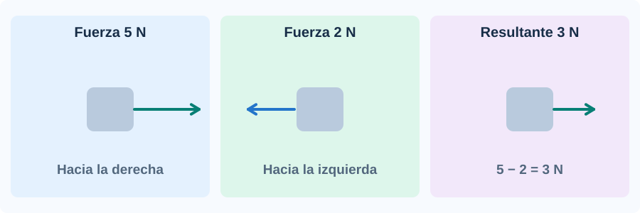

[← Portada](../README.md) · [Índice](../README.md) · [Siguiente →](02.md)

# 01 · ¿Qué es una fuerza?

> Una interacción capaz de cambiar el movimiento.

*Modelo didáctico; dimensiones y flechas no están a escala salvo indicación.*

## Paso 1

Empujar una caja puede cambiar su velocidad o dirección. Una fuerza no es energía: se mide en newtons (N), mientras la energía se mide en julios (J).

## Paso 2

Una fuerza tiene magnitud, dirección y sentido: es un vector. Una flecha más larga representa mayor magnitud si usamos la misma escala.

## Paso 3

La fuerza resultante es la suma vectorial de todas las fuerzas. Si la resultante es cero, la aceleración es cero; no significa necesariamente que el objeto esté quieto.

> [!TIP]
> **Ejemplo:** Una caja recibe 5 N hacia la derecha y 2 N hacia la izquierda: la fuerza resultante es 3 N hacia la derecha.

## Tu turno

Dibuja 4 N hacia la izquierda y 7 N hacia la derecha. ¿Cuál es la resultante?

---

[← Portada](../README.md) · [Índice](../README.md) · [Siguiente →](02.md)
