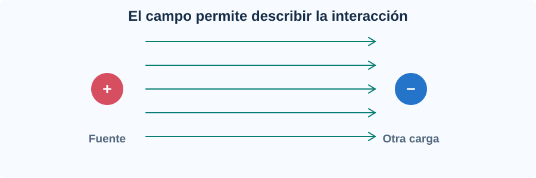

[← Anterior](01.md) · [Índice](../README.md) · [Siguiente →](03.md)

# 02 · ¿Cómo actúan las cargas sin tocarse?

> La interacción electromagnética no requiere contacto.

*Modelo didáctico; dimensiones y flechas no están a escala salvo indicación.*

## Paso 1

En la clase anterior aprendiste que la carga es una propiedad de la materia. Una carga modifica el campo eléctrico en su entorno.

## Paso 2

Otra carga situada en ese entorno experimenta una fuerza. Esto permite describir la interacción sin imaginar un hilo invisible ni electrones saltando entre los cuerpos.

## Paso 3

En electrostática estudiamos cargas en reposo o configuraciones aproximadamente estacionarias. Los cambios del campo no se propagan instantáneamente; este modelo no estudia todavía la propagación electromagnética.

> [!TIP]
> **Ejemplo:** Un globo cargado puede atraer papel neutro por polarización. No necesita tocarlo ni transferirle electrones.

## Tu turno

¿Una fuerza eléctrica requiere contacto? Explica usando el concepto de campo.

---

[← Anterior](01.md) · [Índice](../README.md) · [Siguiente →](03.md)
