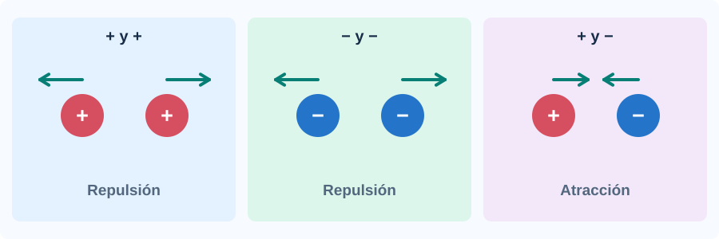
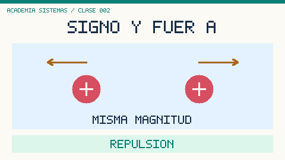

[← Anterior](02.md) · [Índice](../README.md) · [Siguiente →](04.md)

# 03 · Atracción, repulsión y acción-reacción

> El signo decide el sentido, no la magnitud por sí solo.

*Modelo didáctico; dimensiones y flechas no están a escala salvo indicación.*

## Paso 1

Dos cargas positivas se repelen. Dos negativas también. Una positiva y otra negativa se atraen.

## Paso 2

Las fuerzas electrostáticas entre dos cargas puntuales tienen igual magnitud y sentidos opuestos, según la tercera ley de Newton en este modelo. Cada fuerza actúa sobre un cuerpo diferente.

## Paso 3

Si las masas son distintas, pueden tener aceleraciones diferentes aunque las fuerzas tengan igual magnitud. Si están fijas, otras fuerzas las mantienen en su lugar.

## Observa el movimiento

*Fuerzas iguales en magnitud y opuestas en sentido. Las cargas no se desplazan en esta comparación.*

> [!TIP]
> **Ejemplo:** Una carga de +2 µC y una de −6 µC se atraen con fuerzas iguales en magnitud. No es correcto afirmar que la de −6 µC ejerce tres veces más fuerza sobre la otra.

## Tu turno

Dibuja el par de fuerzas para +/+, −/− y +/−.

---

[← Anterior](02.md) · [Índice](../README.md) · [Siguiente →](04.md)
