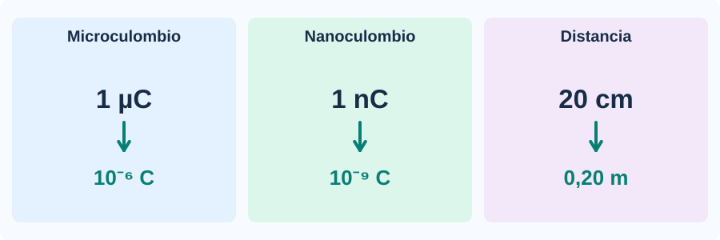

[← Anterior](03.md) · [Índice](../README.md) · [Siguiente →](05.md)

# 04 · Medir cargas y distancias

> Antes de calcular, aprende las unidades.

*Modelo didáctico; dimensiones y flechas no están a escala salvo indicación.*

## Paso 1

El culombio (C) mide carga. En electrostática son frecuentes el microculombio (µC = 10⁻⁶ C) y el nanoculombio (nC = 10⁻⁹ C).

## Paso 2

La ley de Coulomb usa metros para la separación r entre centros de cargas puntuales. 1 cm = 0,01 m; 1 mm = 0,001 m.

## Paso 3

La notación científica ayuda a multiplicar cantidades muy pequeñas. Al multiplicar potencias de diez se suman exponentes; al elevar una potencia al cuadrado se multiplica su exponente por dos.

> [!TIP]
> **Ejemplo:** 2 µC = 2 × 10⁻⁶ C; 20 cm = 0,20 m; (0,20 m)² = 0,04 m².

## Tu turno

Convierte −5 µC, 80 nC y 15 cm a unidades SI. Calcula (0,15)².

---

[← Anterior](03.md) · [Índice](../README.md) · [Siguiente →](05.md)
