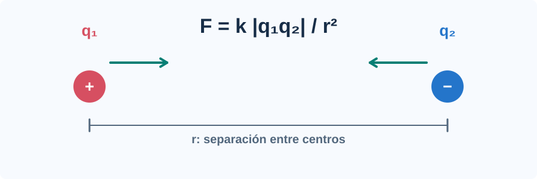

[← Anterior](04.md) · [Índice](../README.md) · [Siguiente →](06.md)

# 05 · Ley de Coulomb: ¿qué determina la fuerza?

> Cuanto mayores las cargas, mayor la fuerza; cuanto más lejos, menor.

*Modelo didáctico; dimensiones y flechas no están a escala salvo indicación.*

## Paso 1

Para dos cargas puntuales en reposo en el vacío: F = k |q₁q₂| / r². En aire se usa a menudo la misma aproximación. k ≈ 8,99 × 10⁹ N·m²/C²; en clase redondeamos a 9 × 10⁹.

## Paso 2

F es la magnitud de la fuerza en N. q₁ y q₂ son las cargas en C; r es la separación en m. El valor absoluto evita que una magnitud sea negativa.

## Paso 3

El sentido se determina por los signos y la línea que une las cargas. En otros medios, la permitividad puede modificar la interacción; la fórmula puntual no describe cualquier objeto extenso a cualquier distancia.

> [!TIP]
> **Ejemplo:** Si duplicamos solo q₁, F se duplica. Si duplicamos ambas cargas, F se cuadruplica. Si duplicamos r, F queda en un cuarto.

## Tu turno

¿Qué ocurre con F si una carga se triplica y la distancia se duplica al mismo tiempo?

---

[← Anterior](04.md) · [Índice](../README.md) · [Siguiente →](06.md)
