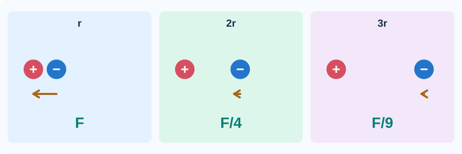
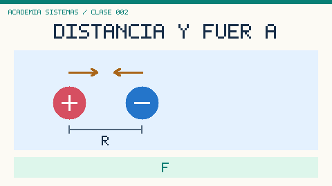

[← Anterior](05.md) · [Índice](../README.md) · [Siguiente →](07.md)

# 06 · ¿Por qué aparece la distancia al cuadrado?

> El campo de una carga puntual se distribuye en tres dimensiones.

*Modelo didáctico; dimensiones y flechas no están a escala salvo indicación.*

## Paso 1

Imagina esferas concéntricas centradas en una carga puntual. Su superficie es 4πr². Si duplicas el radio, el área se multiplica por cuatro.

## Paso 2

En simetría esférica, el flujo eléctrico total a través de esas esferas permanece igual para una carga encerrada fija (ley de Gauss, que estudiaremos más adelante). Por eso el campo radial disminuye como 1/r².

## Paso 3

Las líneas de campo son un dibujo para representar dirección y densidad relativa, no cuerdas físicas ni un número real de líneas. La explicación mediante superficie supone simetría esférica.

[▶ Explorar simulador interactivo](https://mangelmorenomoreno.github.io/academia-sistemas/modulos/01-electronica-basica/clases/002-carga-electricidad-energia/simulador.html) · [PhET Cargas y campos](https://phet.colorado.edu/es/simulations/charges-and-fields)

## Observa el movimiento

*Con cargas fijas, al duplicar o triplicar la distancia la fuerza disminuye a F/4 o F/9. Las posiciones se ajustan externamente en este modelo.*

> [!TIP]
> **Ejemplo:** A distancias r, 2r y 3r, las fuerzas relativas para las mismas cargas son 1, 1/4 y 1/9.

## Tu turno

Si a 10 cm la fuerza es 18 N, ¿cuánto sería a 30 cm?

---

[← Anterior](05.md) · [Índice](../README.md) · [Siguiente →](07.md)
