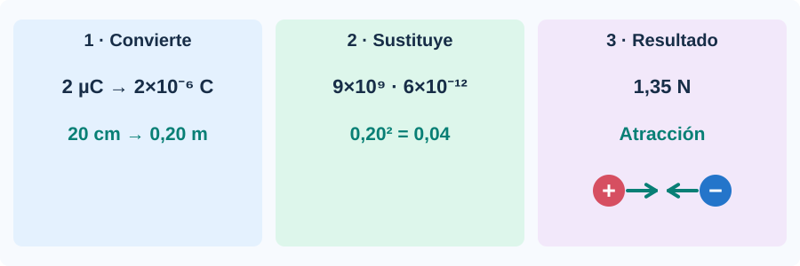

[← Anterior](06.md) · [Índice](../README.md) · [Siguiente →](08.md)

# 07 · Coulomb paso a paso

> Resolver es más que sustituir números.

*Modelo didáctico; dimensiones y flechas no están a escala salvo indicación.*

## Paso 1

Datos: q₁ = +2 µC, q₂ = −3 µC, r = 20 cm. Son opuestas, por tanto se atraen. Convierte a 2×10⁻⁶ C, −3×10⁻⁶ C y 0,20 m.

## Paso 2

Multiplica magnitudes: |q₁q₂| = 6×10⁻¹² C². Eleva distancia: r² = 0,04 m². Multiplica por k: 9×10⁹ × 6×10⁻¹² = 0,054 N·m².

## Paso 3

Divide 0,054 entre 0,04: F = 1,35 N. Dibuja fuerzas iguales que apuntan una hacia la otra. Las unidades C² y m² se cancelan y queda N.

> [!TIP]
> **Ejemplo:** Si r pasa de 0,20 a 0,40 m, F = 1,35/4 = 0,3375 N. El signo de atracción no cambia.

## Tu turno

Resuelve +1 µC y +4 µC a 30 cm. Incluye dibujo, unidades y sentido.

---

[← Anterior](06.md) · [Índice](../README.md) · [Siguiente →](08.md)
