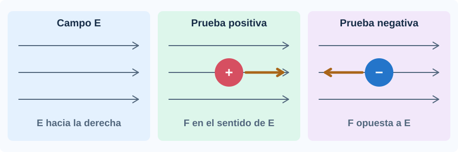
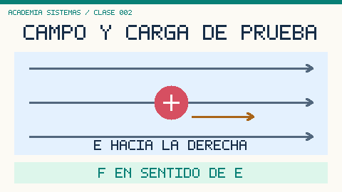

[← Anterior](08.md) · [Índice](../README.md) · [Siguiente →](10.md)

# 09 · Campo y fuerza no son lo mismo

> F = qE: la carga de prueba determina su respuesta.

*Modelo didáctico; dimensiones y flechas no están a escala salvo indicación.*

## Paso 1

Si colocamos una carga positiva en un campo eléctrico, la fuerza tiene el mismo sentido del campo. Si colocamos una negativa, el sentido se invierte.

## Paso 2

Un electrón tiene carga −e ≈ −1,602×10⁻¹⁹ C. En un campo de 100 N/C hacia la derecha, su fuerza eléctrica apunta a la izquierda.

## Paso 3

La magnitud es |q|E. Para el electrón del ejemplo, F = 1,602×10⁻¹⁷ N. Su movimiento real depende además de su velocidad inicial y de otras fuerzas; una flecha de fuerza no es necesariamente una trayectoria.

[▶ Explorar simulador interactivo](https://mangelmorenomoreno.github.io/academia-sistemas/modulos/01-electronica-basica/clases/002-carga-electricidad-energia/simulador.html) · [PhET Cargas y campos](https://phet.colorado.edu/es/simulations/charges-and-fields)

## Observa el movimiento

*El campo permanece fijo. Cambiar el signo de la carga de prueba invierte la fuerza.*

> [!TIP]
> **Ejemplo:** Con E = 300 N/C hacia la derecha, una carga −2 µC siente 0,0006 N hacia la izquierda.

## Tu turno

Dibuja E hacia arriba y fuerzas sobre +3 µC y −3 µC. ¿Cuál es mayor en magnitud?

---

[← Anterior](08.md) · [Índice](../README.md) · [Siguiente →](10.md)
