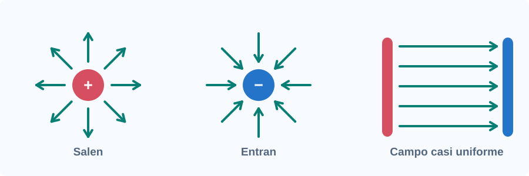

[← Anterior](09.md) · [Índice](../README.md) · [Siguiente →](11.md)

# 10 · Leer un mapa de campo

> Las flechas indican hacia dónde empujaría una carga positiva.

*Modelo didáctico; dimensiones y flechas no están a escala salvo indicación.*

## Paso 1

Las líneas electrostáticas salen de cargas positivas y terminan en negativas o en el infinito; también pueden venir del infinito hacia una carga negativa.

## Paso 2

La tangente a una línea indica la dirección de E. Las líneas no se cruzan en puntos donde E tiene dirección definida. Una mayor densidad relativa sugiere mayor magnitud en diagramas comparables.

## Paso 3

Entre placas paralelas grandes y con cargas opuestas, lejos de los bordes, el campo puede aproximarse como uniforme. Esto anticipa el estudio de voltaje y condensadores.

> [!TIP]
> **Ejemplo:** En un campo uniforme las flechas son paralelas y de igual longitud. No ocurre así alrededor de una carga puntual aislada.

## Tu turno

Compara una carga positiva, una negativa y dos placas. Marca el sentido de E.

---

[← Anterior](09.md) · [Índice](../README.md) · [Siguiente →](11.md)
