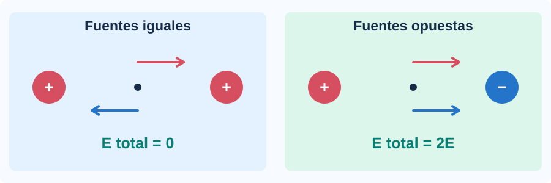

[← Anterior](10.md) · [Índice](../README.md) · [Siguiente →](12.md)

# 11 · Superposición: varios campos a la vez

> Cada fuente aporta un vector; se suman todos.

*Modelo didáctico; dimensiones y flechas no están a escala salvo indicación.*

## Paso 1

El campo total en un punto es la suma vectorial de los campos individuales. Calcula cada aporte antes de sumar; no sumes magnitudes sin mirar sentidos.

## Paso 2

En el punto medio entre dos cargas positivas iguales, ambos campos tienen igual magnitud y sentidos opuestos: E total = 0. Las cargas fuente no desaparecen.

## Paso 3

En el punto medio entre +Q y −Q iguales, ambos campos apuntan hacia la negativa: se suman. Si las direcciones no son colineales, se suman componentes x e y.

[▶ Explorar simulador interactivo](https://mangelmorenomoreno.github.io/academia-sistemas/modulos/01-electronica-basica/clases/002-carga-electricidad-energia/simulador.html) · [PhET Cargas y campos](https://phet.colorado.edu/es/simulations/charges-and-fields)

> [!TIP]
> **Ejemplo:** Dos cargas +1 µC separadas 2 m: en el centro cada campo vale 9.000 N/C, pero se cancelan. Si la derecha fuera −1 µC, E total = 18.000 N/C hacia la derecha.

## Tu turno

Dibuja dos cargas positivas iguales y coloca el punto de prueba más cerca de la izquierda. ¿Hacia dónde apunta E total?

---

[← Anterior](10.md) · [Índice](../README.md) · [Siguiente →](12.md)
