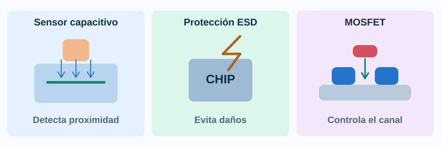

[← Anterior](11.md) · [Índice](../README.md) · [Siguiente →](13.md)

# 12 · Aplicaciones en ingeniería

> De los campos a los dispositivos.

*Modelo didáctico; dimensiones y flechas no están a escala salvo indicación.*

## Paso 1

Una pantalla táctil capacitiva detecta cambios de capacitancia asociados a la proximidad del dedo; el campo eléctrico participa en el fenómeno. No es necesario que se transfieran electrones al vidrio.

## Paso 2

Una descarga electrostática (ESD) puede dañar componentes semiconductores: una diferencia de potencial puede producir un pulso de corriente. Por eso se usan medidas de protección ESD.

## Paso 3

En transistores MOSFET, un campo eléctrico asociado a la puerta controla las condiciones de conducción del canal. Comprender campo eléctrico ayuda a entender este mecanismo más adelante.

> [!TIP]
> **Ejemplo:** La electrostática explica parte del funcionamiento de sensores y la necesidad de proteger circuitos, pero no sustituye el estudio de corriente, energía y semiconductores.

## Tu turno

Busca un ejemplo de sensor capacitivo y explica qué propiedad se detecta. No provoques descargas en equipos.

---

[← Anterior](11.md) · [Índice](../README.md) · [Siguiente →](13.md)
