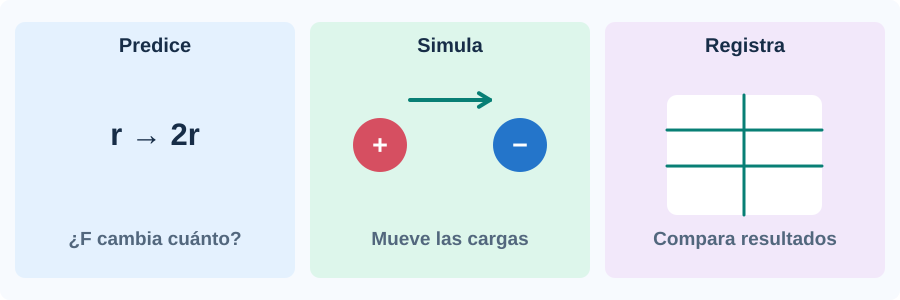

[← Anterior](12.md) · [Índice](../README.md) · [Siguiente →](14.md)

# 13 · Laboratorio virtual: medir y predecir

> La simulación permite comprobar relaciones sin riesgos.

*Modelo didáctico; dimensiones y flechas no están a escala salvo indicación.*

## Paso 1

Usa el simulador integrado o PhET. Mantén q₁ y q₂ fijas, registra la fuerza a r = 10, 20 y 30 cm. Antes de cambiar r, predice la relación.

## Paso 2

Cambia el signo de q₂ conservando su magnitud. Observa cómo cambia el sentido pero no la magnitud. Luego duplica únicamente q₁.

## Paso 3

En PhET Cargas y campos, coloca una fuente positiva, mueve el sensor y observa dirección y magnitud. Compara el campo de dos fuentes iguales y opuestas en su punto medio.

> [!TIP]
> **Ejemplo:** Registra columnas q₁, q₂, r, F predicha, F observada, sentido y error relativo. En el simulador local los datos son calculados, no mediciones independientes.

## Tu turno

Entrega tres dibujos, tabla de resultados y conclusión. No conectar nada a la red eléctrica.

---

[← Anterior](12.md) · [Índice](../README.md) · [Siguiente →](14.md)
