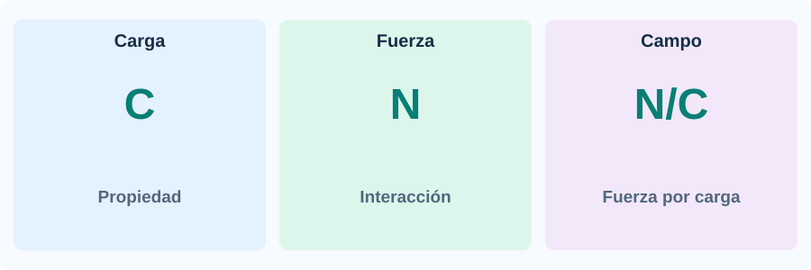

[← Anterior](13.md) · [Índice](../README.md) · [Descargas y cierre →](../descargas.md)

# 14 · Comprueba tus fundamentos

> Antes de avanzar, explica la causa y el cálculo.

*Modelo didáctico; dimensiones y flechas no están a escala salvo indicación.*

## Paso 1

Distingue carga, fuerza y campo con sus unidades. Explica por qué una carga negativa siente una fuerza opuesta a E.

## Paso 2

Resuelve un problema de Coulomb con conversiones y otro de superposición. Comprueba qué ocurre al duplicar la distancia.

## Paso 3

Explica qué condiciones supone el modelo de cargas puntuales y por qué no es correcto decir que las líneas son objetos físicos.

> [!TIP]
> **Ejemplo:** Meta: 80/100 y dominio de signos, unidades, vectores y relación inversa al cuadrado. Si quedan dudas, repite las páginas correspondientes.

## Tu turno

Presenta la prueba sin apuntes y sustenta tus respuestas. Sigue a clase 003: energía, trabajo y conservación.

---

[← Anterior](13.md) · [Índice](../README.md) · [Descargas y cierre →](../descargas.md)
