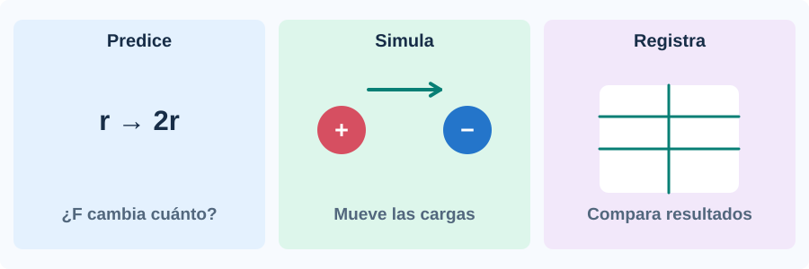

# Laboratorio virtual

[Simulador](https://mangelmorenomoreno.github.io/academia-sistemas/modulos/01-electronica-basica/clases/002-carga-electricidad-energia/simulador.html) · [PhET](https://phet.colorado.edu/es/simulations/charges-and-fields) · [PDF](02-laboratorio.pdf)

## Predicción y tabla

Usa q₁=+2 µC, q₂=−3 µC; calcula antes de simular r=10, 20, 30 cm. Registra predicción, resultado calculado y dirección.

## Variación de signo y magnitud

Mantén r=20 cm; cambia q₂ a +3 µC. Duplica q₁. Explica cuáles cambios afectan sentido y cuáles magnitud.

## Mapa de campo

En PhET añade +1 nC y sensor. Mueve sensor a distancias distintas; repite con −1 nC. Luego coloca dos fuentes iguales y encuentra punto medio. Dibuja flechas.

## Informe

Incluye hipótesis, tabla, tres dibujos, comparación, limitaciones, conclusión. La simulación local usa la misma ecuación y no constituye evidencia experimental independiente. Solo simulación.

| Ensayo | q₁ | q₂ | r | F predicha | F simulada | Sentido |
|---|---|---|---|---|---|---|
| 1 | | | | | | |
| 2 | | | | | | |
| 3 | | | | | | |

Rúbrica: predicciones 25, registro 25, explicación 40, presentación 10.
