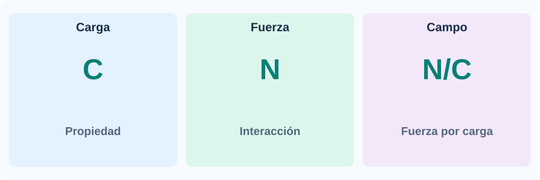

# Prueba individual · 100 puntos

40 minutos, sin apuntes. Usar k=9×10⁹. Meta 80/100 y dominio conceptual.

1. (20 puntos) Representa tres pares de fuerzas para signos iguales y opuestos; explica acción-reacción.
2. (15 puntos) Convierte 3 µC, −5 nC, 15 cm; explica N frente a N/C.
3. (20 puntos) Calcula F de +2 µC y −4 µC a 30 cm. Dibuja sentidos y unidades.
4. (15 puntos) Si duplicas la distancia y triplicas una carga, ¿qué factor cambia F? Justifica.
5. (15 puntos) Calcula E a 1 m de +1 µC y fuerza sobre −2 µC; indica sentidos.
6. (15 puntos) Dos +1 µC a 2 m: E en el centro; luego invierte signo de una y explica el resultado.

[PDF](02-evaluacion.pdf) · [← Índice](../README.md)
