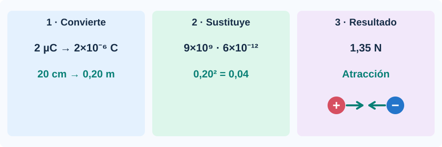

# Solucionario docente

Consultar después de resolver.

## Ejercicios

1. 3 N derecha.
2. Atracción; igual magnitud, sentidos opuestos, actúan sobre cuerpos distintos.
3. 3×10⁻⁶ C; −2×10⁻⁸ C; 0,25 m.
4. 0,40 N; repulsión.
5. 1,35 N; atracción.
6. 2 N, porque 18/9=2.
7. 3/4 de F inicial.
8. 4.500 N/C alejándose de Q (9×10⁹×2×10⁻⁶/4).
9. 0,0006 N izquierda.
10. 1,602×10⁻¹⁷ N izquierda.
11. 0; al invertir derecha, 18.000 N/C derecha.
12. Sí, cancelación vectorial; no, E indica fuerza por carga positiva, no trayectoria.
13. Carga puntual ideal o aproximación de cuerpos pequeños/lejanos; medio y régimen electrostático importan.
14. El campo permite controlar portadores; ESD es un transitorio que puede dañar componentes; corriente es transporte de carga.

## Rúbrica de prueba

1. 20: 6 por pares, 8 por sentidos y fuerzas en cuerpos distintos, 6 por explicación de magnitudes.
2. 15: 3×10⁻⁶ C, −5×10⁻⁹ C, 0,15 m (9); N fuerza, N/C campo (6).
3. 20: 0,8 N, atracción; conversiones 6, procedimiento 6, valor 4, sentidos 4.
4. 15: F nueva=3F/4; relación con q y r², 10; resultado 5.
5. 15: E=9.000 N/C hacia afuera (7); F=0,018 N hacia fuente (8).
6. 15: 0 (5), 18.000 N/C hacia negativa (5), explicación vectorial (5).

## Laboratorio

A 10, 20 y 30 cm: 5,4 N; 1,35 N; 0,6 N. Signo opuesto atrae; igual repele. Duplicar q₁ duplica F. Resultados ideales.

[PDF](02-solucionario.pdf) · [← Índice](../README.md)
