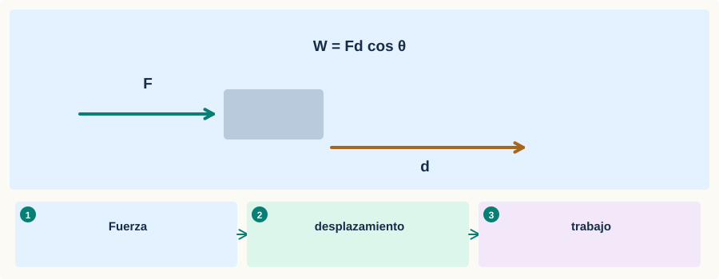
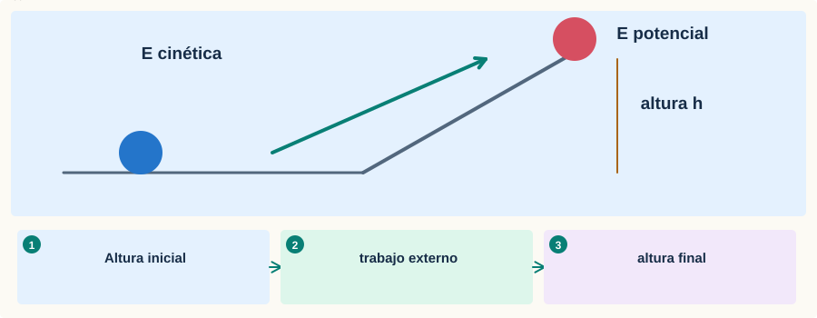
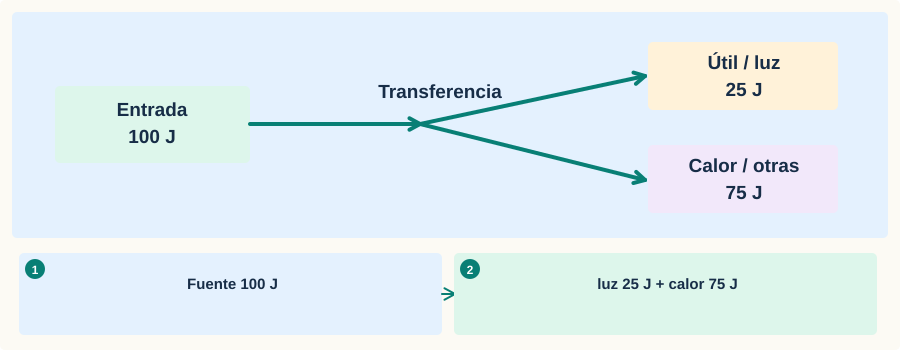
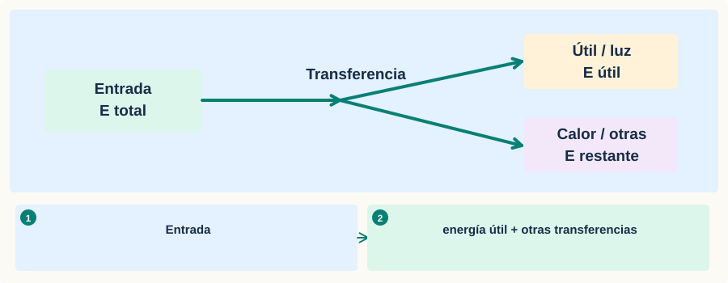
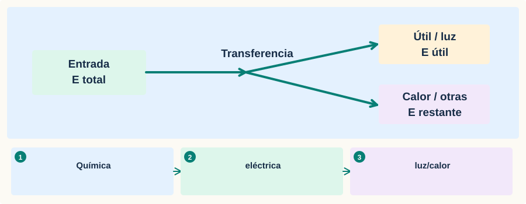

# Cuaderno de ejercicios · Clase 003

[PDF](003-ejercicios.pdf) · [← Índice](../README.md)

## 1. Energía: capacidad de producir cambios

**Ejemplo de estudio:** Una pelota de 2 kg que viaja a 3 m/s tiene Ec=½mv²=9 J.

**Resuelve:** Una pelota de 4 kg viaja a 2 m/s. ¿Cuál es Ec?

Escribe datos, procedimiento, unidades (si corresponde), dibujo y justificación. No consultes la solución antes.

## 2. Trabajo: cómo una fuerza transfiere energía

**Ejemplo de estudio:** 5 N durante 3 m en la misma dirección: W=15 J. Si la fuerza se opone, W=−15 J.

**Resuelve:** Una fuerza de 10 N desplaza 2 m perpendicularmente. ¿Qué trabajo hace?

Escribe datos, procedimiento, unidades (si corresponde), dibujo y justificación. No consultes la solución antes.

## 3. Energía potencial y referencia

**Ejemplo de estudio:** 1 kg elevado 2 m: ΔUg≈19,6 J con g=9,8 m/s².

**Resuelve:** Eleva 2 kg 3 m. Calcula ΔUg.

Escribe datos, procedimiento, unidades (si corresponde), dibujo y justificación. No consultes la solución antes.

## 4. Ley de conservación: sistema y entorno

**Ejemplo de estudio:** Una fuente entrega 100 J; salen 25 J como luz y 75 J como calor en un modelo ideal sin almacenamiento. Balance: 100=25+75.

**Resuelve:** Llegan 60 J, salen 15 J de luz y 35 J de calor. ¿Cuánto aumenta la energía almacenada?

Escribe datos, procedimiento, unidades (si corresponde), dibujo y justificación. No consultes la solución antes.

## 5. Eficiencia y transformación

**Ejemplo de estudio:** Un dispositivo recibe 200 J y entrega 80 J útiles: η=40%; 120 J se transfieren a otras formas o al entorno.

**Resuelve:** Si un motor recibe 500 J y entrega 350 J mecánicos, calcula η.

Escribe datos, procedimiento, unidades (si corresponde), dibujo y justificación. No consultes la solución antes.

## 6. De la pila al computador

**Ejemplo de estudio:** Un circuito recibe 12 J y libera 10 J al entorno; 2 J quedan almacenados temporalmente.

**Resuelve:** ¿Por qué apagar un equipo no significa destruir su energía?

Escribe datos, procedimiento, unidades (si corresponde), dibujo y justificación. No consultes la solución antes.
