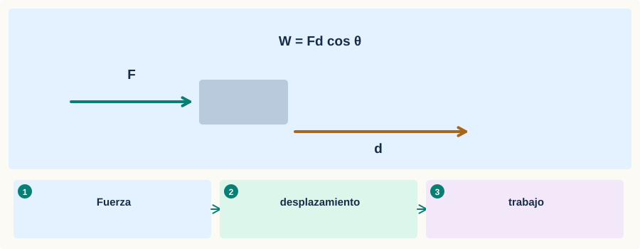
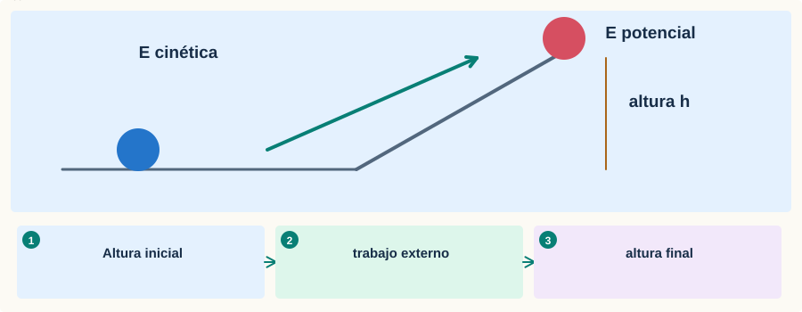
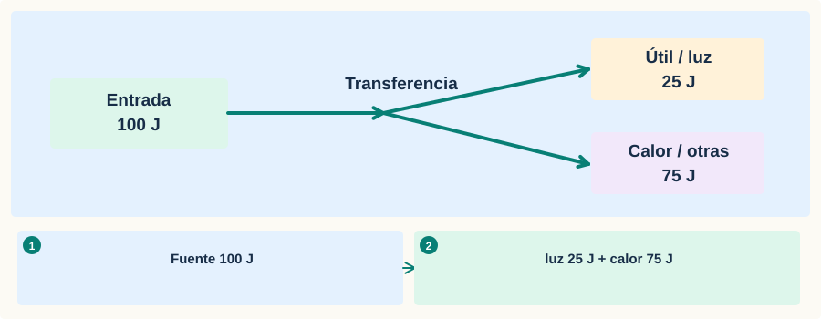
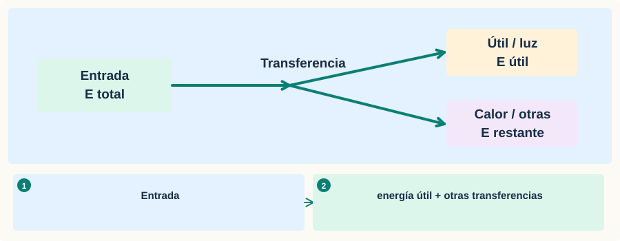
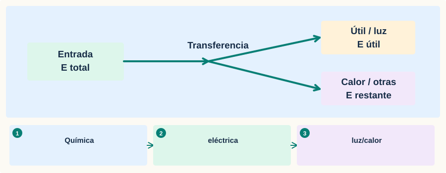

# Energía, trabajo y conservación de la energía

[← Índice](../README.md)

## 01 · Energía: capacidad de producir cambios

La energía es una magnitud física que permite cuantificar cambios y transferencias. Un cuerpo en movimiento posee energía cinética; una pila almacena energía química; un objeto elevado tiene energía potencial gravitatoria respecto a una referencia. No es una sustancia ni una carga eléctrica. Su unidad SI es el julio (J).

**Ejemplo:** Una pelota de 2 kg que viaja a 3 m/s tiene Ec=½mv²=9 J.

**Aplica:** Una pelota de 4 kg viaja a 2 m/s. ¿Cuál es Ec?

---

## 02 · Trabajo: cómo una fuerza transfiere energía

Para una fuerza constante, W=Fd cos θ. F es magnitud en N, d desplazamiento en m y θ el ángulo entre ambos. Si empujas a favor del desplazamiento, el trabajo es positivo; en contra, negativo; perpendicular, cero. Una fuerza sin desplazamiento no realiza trabajo mecánico sobre ese cuerpo.

**Ejemplo:** 5 N durante 3 m en la misma dirección: W=15 J. Si la fuerza se opone, W=−15 J.

**Aplica:** Una fuerza de 10 N desplaza 2 m perpendicularmente. ¿Qué trabajo hace?

---

## 03 · Energía potencial y referencia

La energía potencial describe una configuración de un sistema. Cerca de la superficie terrestre, ΔUg=mgΔh. Elevar una masa requiere transferir energía; al caer puede aumentar su energía cinética. El valor absoluto depende de la referencia, pero los cambios son físicos. En electricidad aparecerá una relación semejante entre carga y potencial.

**Ejemplo:** 1 kg elevado 2 m: ΔUg≈19,6 J con g=9,8 m/s².

**Aplica:** Eleva 2 kg 3 m. Calcula ΔUg.

---

## 04 · Ley de conservación: sistema y entorno

La energía total de un sistema aislado permanece constante. En un sistema que intercambia energía, ΔE=Eentrante−Esaliente. Hay que definir la frontera: si una batería y una lámpara están dentro, la energía química disminuye y aumenta o sale energía térmica y luminosa. El calor no es energía destruida, sino una vía de transferencia por diferencia de temperatura.

**Ejemplo:** Una fuente entrega 100 J; salen 25 J como luz y 75 J como calor en un modelo ideal sin almacenamiento. Balance: 100=25+75.

**Aplica:** Llegan 60 J, salen 15 J de luz y 35 J de calor. ¿Cuánto aumenta la energía almacenada?

---

## 05 · Eficiencia y transformación

La eficiencia se define como energía útil dividida por energía de entrada, multiplicada por 100%. Qué es útil depende del objetivo: el calor es útil en una calefacción, pero normalmente no en un LED. Una eficiencia menor que 100% no viola la conservación.

**Ejemplo:** Un dispositivo recibe 200 J y entrega 80 J útiles: η=40%; 120 J se transfieren a otras formas o al entorno.

**Aplica:** Si un motor recibe 500 J y entrega 350 J mecánicos, calcula η.

---

## 06 · De la pila al computador

La reacción química de una batería sostiene una diferencia de potencial. Al cerrar un circuito, el campo electromagnético permite transferir energía a los componentes; la carga se conserva. Un procesador convierte energía eléctrica principalmente en calor y en operaciones físicas de conmutación; la información no es una forma de energía que sustituya el balance.

**Ejemplo:** Un circuito recibe 12 J y libera 10 J al entorno; 2 J quedan almacenados temporalmente.

**Aplica:** ¿Por qué apagar un equipo no significa destruir su energía?

---
