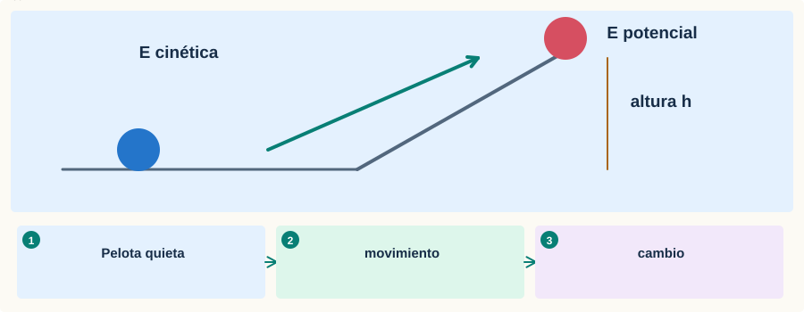

[← Portada](../README.md) · [Índice](../README.md) · [Siguiente →](02.md)

# 01 · Energía: capacidad de producir cambios

*Diagrama didáctico y secuencia conceptual; no a escala.*

## ¿Qué es y por qué ocurre?

La energía es una magnitud física que permite cuantificar cambios y transferencias. Un cuerpo en movimiento posee energía cinética; una pila almacena energía química; un objeto elevado tiene energía potencial gravitatoria respecto a una referencia. No es una sustancia ni una carga eléctrica. Su unidad SI es el julio (J).

## Ejemplo explicado

> Una pelota de 2 kg que viaja a 3 m/s tiene Ec=½mv²=9 J.

## Ahora tú

Una pelota de 4 kg viaja a 2 m/s. ¿Cuál es Ec?

[← Portada](../README.md) · [Índice](../README.md) · [Siguiente →](02.md)
