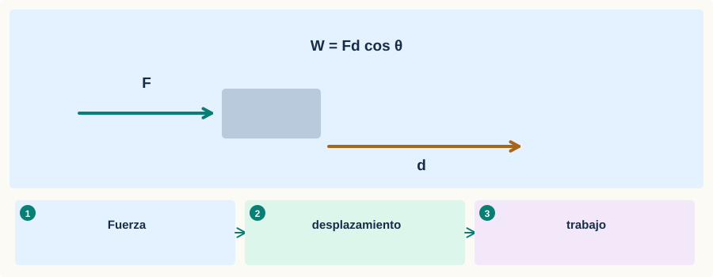
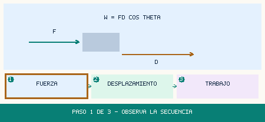

[← Anterior](01.md) · [Índice](../README.md) · [Siguiente →](03.md)

# 02 · Trabajo: cómo una fuerza transfiere energía

*Diagrama didáctico y secuencia conceptual; no a escala.*

## ¿Qué es y por qué ocurre?

Para una fuerza constante, W=Fd cos θ. F es magnitud en N, d desplazamiento en m y θ el ángulo entre ambos. Si empujas a favor del desplazamiento, el trabajo es positivo; en contra, negativo; perpendicular, cero. Una fuerza sin desplazamiento no realiza trabajo mecánico sobre ese cuerpo.

## Ejemplo explicado

> 5 N durante 3 m en la misma dirección: W=15 J. Si la fuerza se opone, W=−15 J.

## Ahora tú

Una fuerza de 10 N desplaza 2 m perpendicularmente. ¿Qué trabajo hace?

## Secuencia animada

*Se resaltan etapas del diagrama, no se pretende simular el movimiento físico real.*

[← Anterior](01.md) · [Índice](../README.md) · [Siguiente →](03.md)
