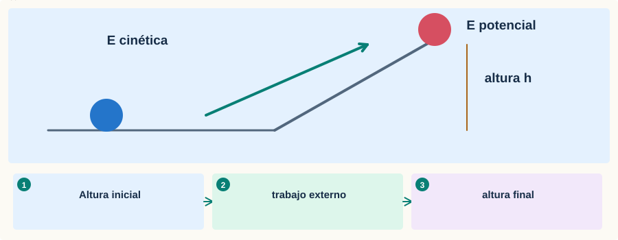

[← Anterior](02.md) · [Índice](../README.md) · [Siguiente →](04.md)

# 03 · Energía potencial y referencia

*Diagrama didáctico y secuencia conceptual; no a escala.*

## ¿Qué es y por qué ocurre?

La energía potencial describe una configuración de un sistema. Cerca de la superficie terrestre, ΔUg=mgΔh. Elevar una masa requiere transferir energía; al caer puede aumentar su energía cinética. El valor absoluto depende de la referencia, pero los cambios son físicos. En electricidad aparecerá una relación semejante entre carga y potencial.

## Ejemplo explicado

> 1 kg elevado 2 m: ΔUg≈19,6 J con g=9,8 m/s².

## Ahora tú

Eleva 2 kg 3 m. Calcula ΔUg.

[← Anterior](02.md) · [Índice](../README.md) · [Siguiente →](04.md)
